# Inteligencia Musical: Predicción de Hits en Spotify

**Asignatura:** MLY1101 Machine Learning · Duoc UC · Evaluación Parcial N°3
**Caso C:** Inteligencia musical y predicción de popularidad de canciones (Spotify Tracks)
**Grupo 8:** Johan Soto, Fernanda Alcaino
**Repositorio:** `Joh4nSoto/MachineLearningSpotifyTracks`

---

## Resumen ejecutivo

**Pregunta de negocio.** Un sello discográfico debe decidir *antes del lanzamiento* en qué canciones invertir su
presupuesto de promoción. ¿Podemos anticipar, solo con información disponible al lanzar, qué canciones serán un
**hit** (`popularity ≥ 50`, el 24% superior del catálogo)?

**Respuesta corta.** Sí, pero menos de lo que creíamos. El modelo elegido (**XGBoost**) ordena las canciones
**2.6 veces mejor que el azar** (PR-AUC 0.62 frente a 0.24) y, con el umbral de negocio, **descubre 71 de cada 100
hits** gastando el **47% del presupuesto en canciones que no lo serán**, frente al **76%** que se perdería
promocionando al azar. Todo esto medido con **artistas que el modelo nunca vio**, que es el caso real del negocio.

**Lo más importante que aprendimos:**

1. **La versión anterior (EV2 original) estaba inflada por fuga de datos.** Reportaba PR-AUC 0.85 porque el modelo
   "conocía" a los artistas y álbumes del test. Al corregirlo, el desempeño honesto es 0.62. La diferencia no era
   capacidad predictiva, era información que en la vida real no existe al lanzar una canción.
2. **La música por sí sola explica solo ~9% de la popularidad.** El 81% de lo que el modelo usa es el **género**,
   es decir, qué mercados premia la plataforma. El éxito depende más del contexto que del sonido (efecto Mateo).
3. **El modelo discrimina fuertemente a los géneros de nicho:** detecta el 93% de los hits de géneros mainstream,
   pero solo el 4% de los hits de géneros de nicho. Por eso **no debe usarse como filtro automático**.
4. **Varias metas de KPI se fijaron con el modelo que tenía fuga** y hoy no son alcanzables (Waste ≤ 15% implicaría
   detectar solo el 8% de los hits). Proponemos redefinirlas respecto del azar.

**Recomendación.** Usar XGBoost como **herramienta de priorización** (no de decisión automática), con umbral
documentado, re-ranking con cupo por género, cuota para artistas emergentes y revisión humana.

| | EV2 original (con fuga) | **EV3 final (honesto)** |
|---|---|---|
| Cómo se evaluó | Split aleatorio + Target Encoding de artista/álbum | Split y validación **por artista** (nunca vistos) |
| PR-AUC test | 0.849 | **0.619** (azar: 0.241) |
| ROC-AUC test | 0.939 | **0.842** |
| ¿Es creíble en producción? | No: usaba información del futuro | **Sí:** CV y test coinciden (0.623 vs 0.619) |

---

## Índice

1. [Problema de negocio y objetivos](#1-problema-de-negocio-y-objetivos)
2. [KPIs del proyecto](#2-kpis-del-proyecto)
3. [Fuente de datos](#3-fuente-de-datos)
4. [Metodología CRISP-DM y herramientas](#4-metodología-crisp-dm-y-herramientas)
5. [Estructura del proyecto y reproducibilidad](#5-estructura-del-proyecto-y-reproducibilidad)
6. [EV1 — Comprensión y preparación de datos (resumen)](#6-ev1--comprensión-y-preparación-de-datos-resumen)
7. [EV2 — Modelamiento, la fuga de datos y su corrección (resumen)](#7-ev2--modelamiento-la-fuga-de-datos-y-su-corrección-resumen)
8. [EV3 — Optimización, ensambles, generalización y selección (desarrollo principal)](#8-ev3--optimización-ensambles-generalización-y-selección)
9. [Registro de errores, ajustes y decisiones](#9-registro-de-errores-ajustes-y-decisiones)
10. [Sesgos del modelo: evidencia, mitigación, impacto y precauciones](#10-sesgos-del-modelo-evidencia-mitigación-impacto-y-precauciones)
11. [Ética, privacidad y marco normativo](#11-ética-privacidad-y-marco-normativo)
12. [Viabilidad financiera (simulación)](#12-viabilidad-financiera-simulación)
13. [Conclusiones, limitaciones y recomendaciones para el negocio](#13-conclusiones-limitaciones-y-recomendaciones-para-el-negocio)
14. [Anexos](#14-anexos)

---

## 1. Problema de negocio y objetivos

### Problema
La industria musical es un mercado saturado: miles de canciones se publican cada día en Spotify y los sellos
invierten en promoción sin certeza de éxito. Cada canción promocionada que no despega es **presupuesto perdido**
(falso positivo) y cada hit que no se promocionó es **oportunidad perdida** (falso negativo).

### Objetivo general
Construir un modelo de Machine Learning que estime la probabilidad de que una canción sea un hit, usando **solo
información disponible al momento del lanzamiento**, para priorizar la inversión promocional.

### Objetivos específicos
- Preparar y depurar el dataset, eliminando duplicados y fuentes de fuga de información (EV1, EV2).
- Comparar modelos supervisados (Regresión Logística, Árbol, Random Forest, XGBoost, Votación) y uno no
  supervisado (PCA + K-Means) (EV2, EV3).
- Optimizar hiperparámetros y umbral de decisión, y aplicar técnicas de ensamble (EV3).
- Evaluar la capacidad de generalización con validación cruzada agrupada por artista (EV3).
- Seleccionar y justificar la solución óptima según los KPIs de negocio (EV3).
- Cuantificar sesgos y proponer un uso responsable del modelo (EV1–EV3).

### Criterio "información disponible al lanzar"
Una variable entra al modelo solo si (1) se conoce **antes** de publicar la canción y (2) **no contiene la
popularidad** de otras canciones relacionadas. Cumplen: características de audio, duración, contenido explícito,
género y número de artistas. **No cumplen:** la popularidad media del álbum o del artista (se calculan con
reproducciones posteriores). Este criterio es el centro de la corrección de la fuga (Sección 7).

---

## 2. KPIs del proyecto

Tabla única (archivo `data/kpis_spotify.csv`), definida en EV1 y verificada con el modelo final en EV3.
Resultados en el **test de artistas nunca vistos** (XGBoost, umbral 0.55).

| KPI | Qué mide para el negocio | Meta | Resultado | Estado | Lectura |
|---|---|---|---|---|---|
| **Recall@Hit** | De cada 100 hits, cuántos detectamos | ≥ 0.70 | **0.707** | ✅ | Se descubren 71 de cada 100 éxitos |
| **PR-AUC** | Calidad de la lista de candidatos a hit | > 0.50 | **0.619** | ✅ | 2.6× mejor que el azar (0.241) |
| **F2-Score** | Balance que prioriza no perder hits | > 0.65 | **0.661** | ✅ | Cumple con poco margen |
| **Waste Rate** | % del presupuesto en canciones que no serán hit | ≤ 0.15 | 0.474 | ❌ | Meta fijada con el modelo con fuga; el azar desperdicia 0.759 |
| **NDCG@20** | Calidad del orden de una playlist de 20 | > 0.80 | 0.668 | ❌ | El orden fino depende de marketing/playlists, no observables |
| **Diversity Score** | Géneros distintos en el top-200 promocionado | ≥ 15 | 8 → **21** con re-ranking | ✅ | Sin cupo, el top-200 se concentra; con cupo de 10% por género sube a 21 |
| **MAE** | Error medio al estimar la popularidad (0–100) | ≤ 10 | 11.8 | ❌ | 32% mejor que predecir siempre la mediana (17.3) |
| **RMSE** | Penaliza errores grandes | < 12 | 16.8 | ❌ | Errores grandes en artistas desconocidos |
| **R²** | % de la popularidad explicado **solo por la música** | ≥ 0.45 | 0.086 | ❌ | **Hallazgo:** la música explica ~9%; el resto es contexto |

**Cumplimiento: 4/9** con la solución operativa recomendada (modelo + re-ranking con cupo por género, que forma
parte de la solución). Sin el re-ranking serían 3/9.

**Por qué no se cumplen los demás y por qué no es un fracaso del modelo:**
- Las metas de EV1 se fijaron antes de descubrir la fuga; con el modelo inflado (PR-AUC 0.85) parecían alcanzables.
- **Waste ≤ 15% y Recall ≥ 70% son incompatibles** con la información disponible al lanzar: con Waste ≤ 15% el
  máximo Recall posible es 0.08; para Recall 70% el desperdicio mínimo es 0.47 (Sección 8.6).
- El **R² bajo responde la pregunta de negocio** del KPI ("¿cuánto del éxito se debe solo a la música?"): poco.
- **Propuesta:** redefinir Waste Rate como mejora respecto del azar (hoy: −29 puntos porcentuales) y fijar metas de
  MAE/NDCG con una línea base honesta.

---

## 3. Fuente de datos

| Elemento | Detalle |
|---|---|
| Dataset original | `Spotify_Tracks_Dataset.csv` (Kaggle), 114.000 filas × 21 columnas, 114 géneros (~1.000 canciones por género) |
| Dataset limpio (EV1) | `spotify_tracks_clean.csv`: **88.732 canciones únicas**, 133 columnas (género como 114 columnas binarias) |
| Variable objetivo | `is_hit = 1` si `popularity ≥ 50` (≈ percentil 75). **Prevalencia: 23.7%** |
| Unidad de agrupación | `artist_primary` (primer artista de la lista): **17.581 artistas** |
| KPIs | `kpis_spotify.csv` |

`popularity` es un índice 0–100 calculado por Spotify a partir del **número de reproducciones y su recencia**: mide
consumo reciente, no calidad musical. El diccionario completo de variables está en el [Anexo A](#a-diccionario-de-datos).

---

## 4. Metodología CRISP-DM y herramientas

| Fase CRISP-DM | Qué hicimos | Entrega |
|---|---|---|
| 1. Comprensión del negocio | Problema de inversión promocional, objetivos, KPIs | EV1 |
| 2. Comprensión de los datos | EDA, calidad, duplicados, sesgos | EV1 |
| 3. Preparación de los datos | Limpieza, multietiqueta, ingeniería de variables, **partición por artista**, pipeline sin fuga | EV1, EV2 |
| 4. Modelado | LR, Árbol, RF, XGBoost, Votación; PCA + K-Means; regresión de popularidad | EV2, EV3 |
| 5. Evaluación | CV K=5 agrupada, ablación, sesgos, KPIs, matriz de decisión | EV2, EV3 |
| 6. Despliegue | Modelo serializado + umbral + política de uso responsable | EV3 |

| Herramienta | Uso |
|---|---|
| Google Colab / Jupyter | Notebooks ejecutables con documentación Markdown |
| Git / GitHub | Control de versiones del equipo |
| pandas, NumPy | Manipulación de datos |
| Matplotlib, Seaborn | Visualización |
| scikit-learn 1.6.1 | Pipelines, validación cruzada, Random Forest, Regresión Logística, PCA, K-Means, métricas |
| XGBoost 3.4.1 | Modelo de boosting |
| joblib | Serialización del modelo y puntos de guardado de cálculos pesados |

---

## 5. Estructura del proyecto y reproducibilidad

```
MachineLearningSpotifyTracks/
├── README.md                          ← este informe
├── requirements.txt
├── data/
│   ├── Spotify_Tracks_Dataset.csv     ← original
│   ├── spotify_tracks_clean.csv       ← salida de EV1 (entrada de EV2 y EV3)
│   ├── kpis_spotify.csv
│   └── spotify_tracks_evaluated.csv   ← salida de EV2 (se genera al ejecutar)
├── notebooks/
│   ├── ev1_ML_EDA_JohanSotoFernandaAlcaino.ipynb
│   ├── ev2_ML_Modelo_JohanSotoFernandaAlcaino.ipynb
│   └── ev3_ML_Optimizacion_JohanSotoFernandaAlcaino.ipynb
├── models/
│   ├── ev3_modelo_final.joblib        ← pipeline ganador + umbral (se genera al ejecutar)
│   └── cache_ev3/                     ← puntos de guardado de EV3 (ignorado por git)
├── images/                            ← todas las figuras del proyecto (ev1_*.png, ev2_*.png, ev3_*.png)
└── reports/                           ← tablas de resultados en CSV (ev2_*.csv, ev3_*.csv; se generan al ejecutar)
```

**Cómo reproducir:**
1. `pip install -r requirements.txt` (scikit-learn ≥ 1.4, xgboost ≥ 2.1.4, pandas, matplotlib, seaborn, joblib).
2. Ejecutar en orden **EV1 → EV2 → EV3** con *Restart & Run All*. Los tres notebooks leen y escriben en `../data/`
   con la función `ubicar()`, que también busca en la carpeta actual y en `/content` de Colab. EV1 regenera
   `spotify_tracks_clean.csv` desde el dataset original.
3. Tiempos aproximados en CPU estándar: EV2 ≈ 10–15 min; EV3 ≈ 40–60 min la primera vez.
4. EV3 guarda cada paso pesado en `models/cache_ev3/`: **si el entorno se reinicia, volver a ejecutar retoma desde
   el último paso guardado**. En Colab, ejecutar desde una carpeta de Google Drive para conservar los guardados.
   `BORRAR_CACHE = True` recalcula todo desde cero.
5. Semilla fija (`RANDOM_STATE = 42`) en particiones, modelos y búsquedas. El modelo exportado se recarga y se
   verifica que reproduce exactamente las predicciones.

---

## 6. EV1 — Comprensión y preparación de datos (resumen)

### 6.1 Calidad de los datos
| Problema | Evidencia | Decisión |
|---|---|---|
| Nulos | 1 fila sin `artists`, `album_name` ni `track_name` (popularidad 0) | Eliminada |
| Duplicados por género | `df.duplicated()` = 0, pero miles de `track_id` repetidos: la misma canción aparecía una vez por cada género | **Agrupar por `track_id`** y convertir el género en 114 columnas binarias (multietiqueta) |
| Registros inválidos | `time_signature` fuera de 3–7 y `tempo` = 0 | Filtrados |
| Resultado | 114.000 → **88.732 canciones únicas** | `spotify_tracks_clean.csv` |

> **Corrección respecto al README anterior:** decía "no hay duplicados". Es cierto solo para duplicados exactos;
> por `track_id` había miles, y fueron la primera fuente de fuga detectada (la misma canción en train y test).

**¿Por qué multietiqueta y no una fila por género?** Con una fila por género, una canción en 5 géneros pesaba 5
veces más en el entrenamiento y podía quedar a la vez en train y test (fuga). Con ~88 mil filas y ~135 columnas
hay más de 600 filas por columna, sin riesgo de maldición de la dimensionalidad.

### 6.2 Hallazgos del EDA

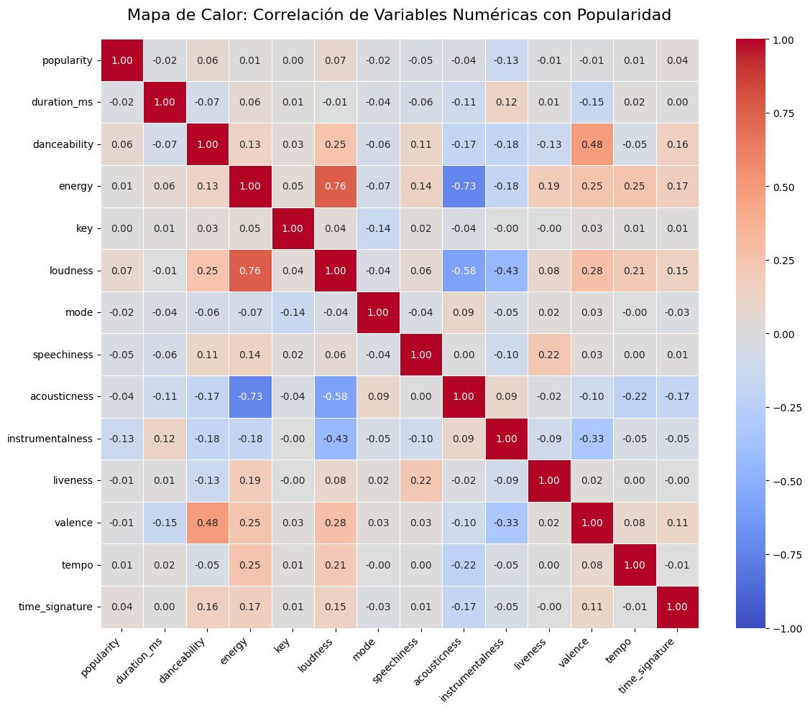

- **Ninguna variable de audio se correlaciona linealmente con la popularidad** (|r| < 0.1). Primera señal de que
  el éxito depende de factores externos al sonido. Las relaciones fuertes son entre variables de audio
  (energía–loudness 0.76; energía–acousticness −0.73).

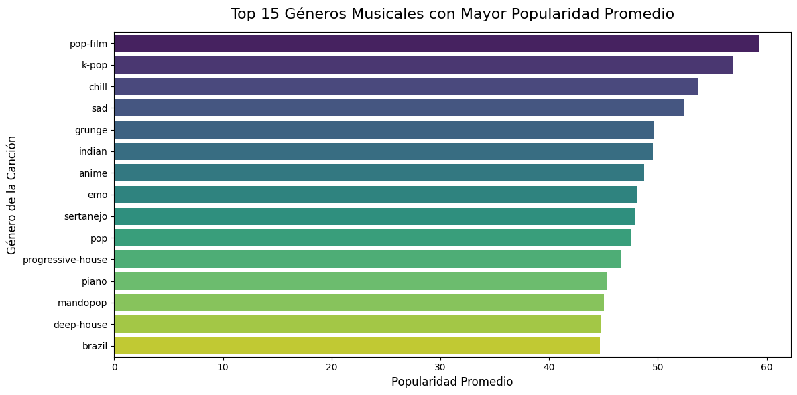
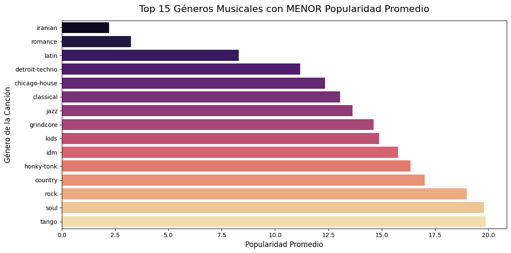

- **El género es la gran diferencia:** pop-film, k-pop y chill lideran; iranian, romance y otros géneros de nicho
  tienen popularidad casi nula. Esto anticipa el sesgo de género que se confirmó en EV3.

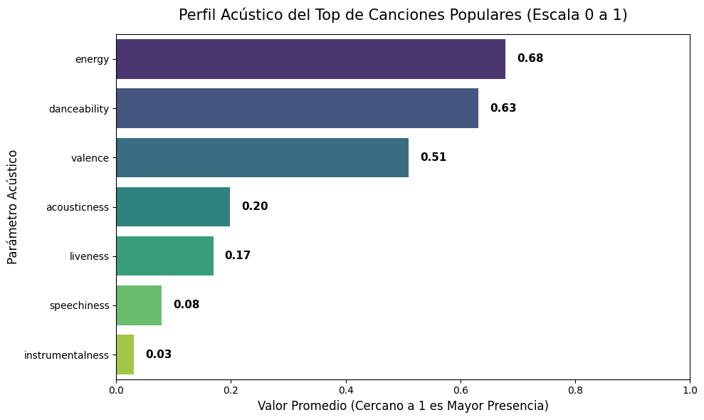

- Las canciones con popularidad ≥ 75 son bailables (~0.65), enérgicas (~0.64), con voz y no en vivo.

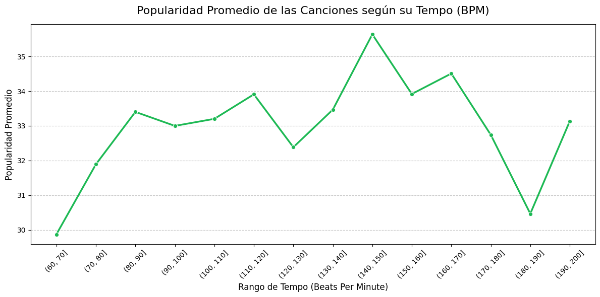
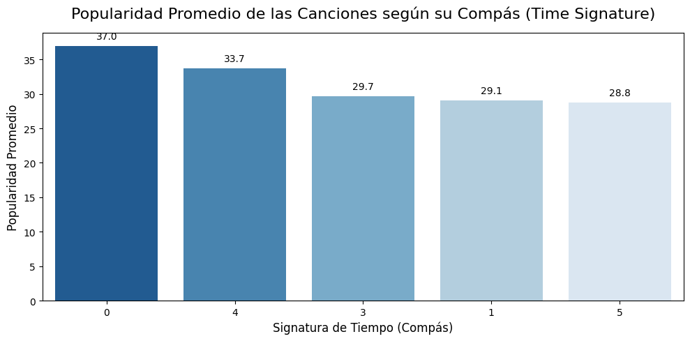

- Tempo favorable entre 80 y 170 BPM; compás 4/4 dominante.

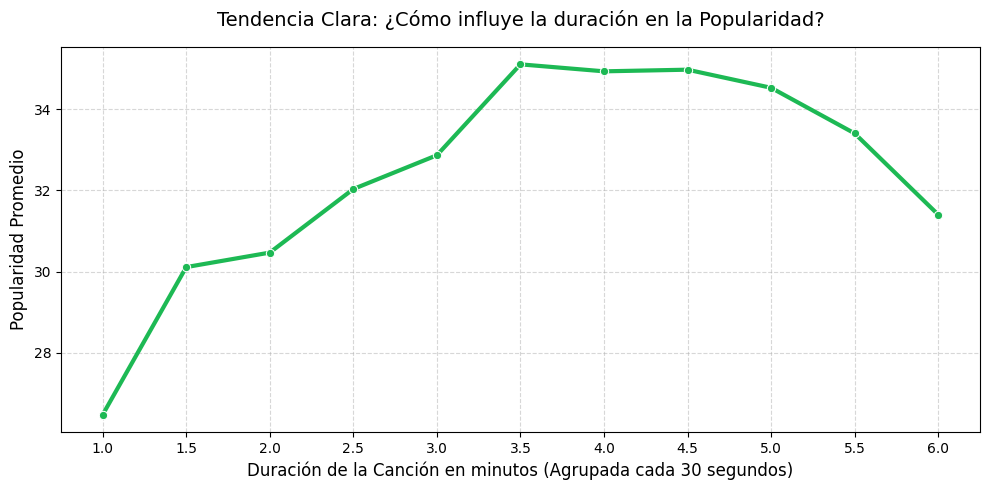

- **Duración:** la popularidad sube hasta ~3.5–4.5 minutos y cae en canciones más largas. Esto justificó las
  variables `duration_min`, `is_short` e `is_long` de EV2.

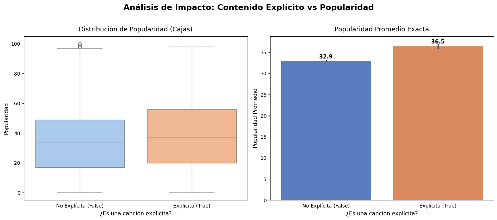

- **Contenido explícito:** popularidad promedio 36.5 frente a 32.9 en canciones no explícitas. Esto justificó la
  interacción `explicit_x_dance`.

### 6.3 Sesgos identificados en EV1
1. **Muestreo por duplicación** (corregido con la agrupación por `track_id`).
2. **Recencia:** `popularity` premia lo escuchado hoy; castiga catálogo histórico valioso.
3. **Retroalimentación positiva (efecto Mateo):** lo ya promocionado acumula reproducciones y vuelve a parecer "hit".
4. **Homogeneización cultural:** géneros de nicho con poca exposición tienen tasas de hit cercanas a 0.

---

## 7. EV2 — Modelamiento, la fuga de datos y su corrección (resumen)

### 7.1 Versión original de EV2 (evaluada en la EP2)
- Ingeniería de variables: `duration_min`, `is_short`, `is_long`, `n_artists`, `energy_x_dance`,
  `valence_x_energy`, `explicit_x_dance`, cada una justificada por el EDA.
- **Balanceo:** `class_weight` / `scale_pos_weight` en lugar de SMOTE, porque SMOTE sobre columnas one-hot crea
  canciones imposibles (`genre_rock = 0.5`, `genre_pop = 0.5`). *(Destacado por el docente.)*
- **Target Encoding** de artista y álbum (`artist_te`, `album_te`) y split aleatorio estratificado por género.
- Umbral optimizado por F2 en validación. Resultado: **XGBoost PR-AUC 0.849, ROC-AUC 0.939, Recall 0.896**.

### 7.2 La retroalimentación: "el ROC-AUC de 0,94 es optimista"
El docente observó que `album_te` (popularidad media de **las otras canciones del mismo álbum**) (1) filtra
información, porque con un split aleatorio canciones del mismo álbum y artista quedaban en train y test, y (2) **no
existe al momento del lanzamiento**. También pidió cifras para las afirmaciones, una sola tabla de KPIs y rutas
reproducibles.

### 7.3 ¿Qué es la fuga de datos y dónde estaba?
**Fuga de datos** = el modelo usa, durante la evaluación, información que no tendría en la vida real. El resultado
se ve excelente en el notebook y falla en producción. Encontramos **tres fuentes**:

| Fuente de fuga | Mecanismo | Evidencia |
|---|---|---|
| **Artistas compartidos** | Con split aleatorio, canciones del mismo artista quedan en train y test: el modelo "reconoce" al artista | CV aleatoria infla el PR-AUC de XGBoost en **+0.060** y el de RF en **+0.075** respecto a la CV por artista (EV3) |
| **Canciones repetidas** | **8.309 canciones** tienen el mismo nombre y artista con otro `track_id` (single y álbum, reediciones): una copia en train y otra en test | Conteo directo en EV2/EV3 |
| **Target Encoding de álbum** | 3.039 nombres de álbum se repiten entre artistas (compilados, playlists, reediciones: "Mega Hits", "Christmas Songs 2022"). Dentro de un álbum la popularidad es muy homogénea (los compilados de temporada tienen tasa de hit 0 porque son copias), así que la media del álbum **adivina la etiqueta** y solo se conoce después del lanzamiento | Aun con artistas nunca vistos, el TE de álbum sube el PR-AUC **+0.091**; el 21.4% de las canciones del test tiene un nombre de álbum que también está en train |

### 7.4 Cómo se corrigió
1. **Partición por artista** con `GroupShuffleSplit` (grupo = artista principal): **ningún artista está en train y
   test** (train: 71.153 canciones / 14.064 artistas; test: 17.579 canciones / 3.517 artistas). Se usa el artista
   principal para que "A" y "A;B" queden del mismo lado.
2. **Eliminación del Target Encoding** de álbum (fuga y no disponible al lanzar) y de artista (con artistas nuevos
   solo devuelve la media global y empeora el resultado: −0.030 de PR-AUC).
3. **Todo paso que aprende dentro de un `Pipeline`** (imputación, escalamiento y, en la ablación, el TE), para que la
   validación cruzada no se contamine.
4. **Selección del modelo en validación, no en test.**

**Prueba: tabla de ablación** (PR-AUC en CV de 3 pliegues sobre train, XGBoost):

| Conjunto de variables | Split aleatorio (como antes) | Split por artista (corregido) | Lectura |
|---|---|---|---|
| 1. Solo audio (14) | 0.405 | 0.377 | La música sola supera al azar (0.236), pero poco |
| 2. + Ingeniería (21) | 0.420 | 0.390 | Aporte pequeño (+0.013) |
| **3. + Género** | 0.680 | **0.626** | **El género aporta +0.236: el mercado pesa más que el sonido** |
| 4. + Catálogo del artista | 0.709 | 0.629 | No aporta con artistas nuevos (+0.003): **excluido** |
| 5. + TE artista | 0.781 | 0.598 | Empeora con artistas nuevos: **excluido** |
| 6. + TE álbum | **0.835** | 0.689 | La cifra "buena" de antes era fuga: **excluido** |

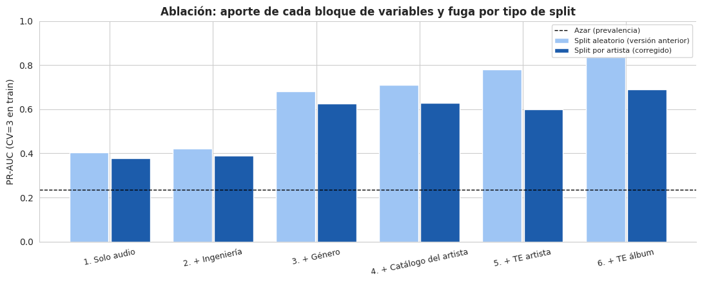

**Decisión:** el modelo final usa el **conjunto 3** (audio + ingeniería + género), llamado *set de lanzamiento*.

### 7.5 Resultados de EV2 corregido (test con artistas nunca vistos)

| Modelo | Umbral F2 | PR-AUC val. | PR-AUC test | ROC-AUC | Recall | Precision | F1 |
|---|---|---|---|---|---|---|---|
| Regresión Logística | 0.374 | 0.609 | 0.572 | 0.821 | 0.886 | 0.406 | 0.557 |
| Random Forest | 0.339 | 0.638 | 0.617 | 0.838 | 0.869 | 0.433 | 0.578 |
| **XGBoost** | 0.445 | **0.649** | **0.623** | **0.843** | 0.856 | 0.451 | **0.591** |

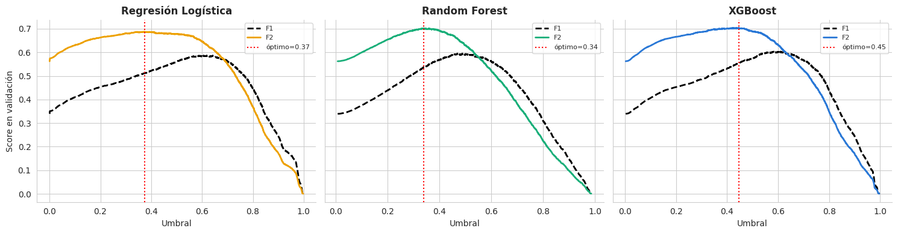

El umbral que maximiza F2 queda bajo 0.5 en los tres modelos (0.34–0.45): con clases desbalanceadas, el umbral por
defecto no es una decisión de negocio.

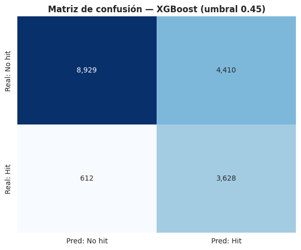

Matriz de confusión de XGBoost: 3.628 hits detectados, 612 hits perdidos, 4.410 promociones desperdiciadas
(**Waste Rate 54.9%**, consecuencia de priorizar recall con F2; EV3 lo reduce).

### 7.6 Otros hallazgos de EV2 corregido
- **Artistas emergentes: la hipótesis no se confirmó.** Se afirmaba que el modelo subestima a los artistas
  emergentes. Medido: los artistas con 1 canción tienen **más** hits (29% contra 22%) y el modelo los detecta
  mejor (recall 0.885 contra 0.843). Los catálogos grandes son sobre todo clásicos, ambient y artistas históricos.
- **Clusters (PCA + K-Means, K=4):** 10 componentes con 89.2% de varianza; K=4 por interpretabilidad (el silhouette
  óptimo era k=2).

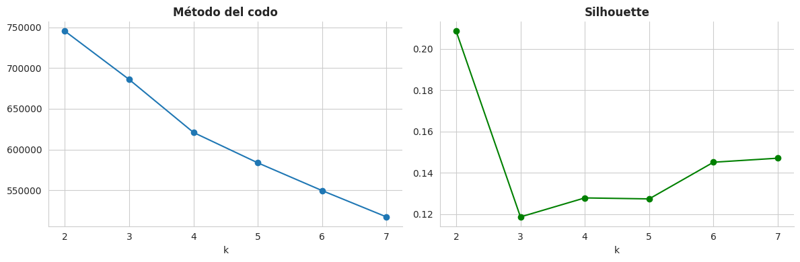
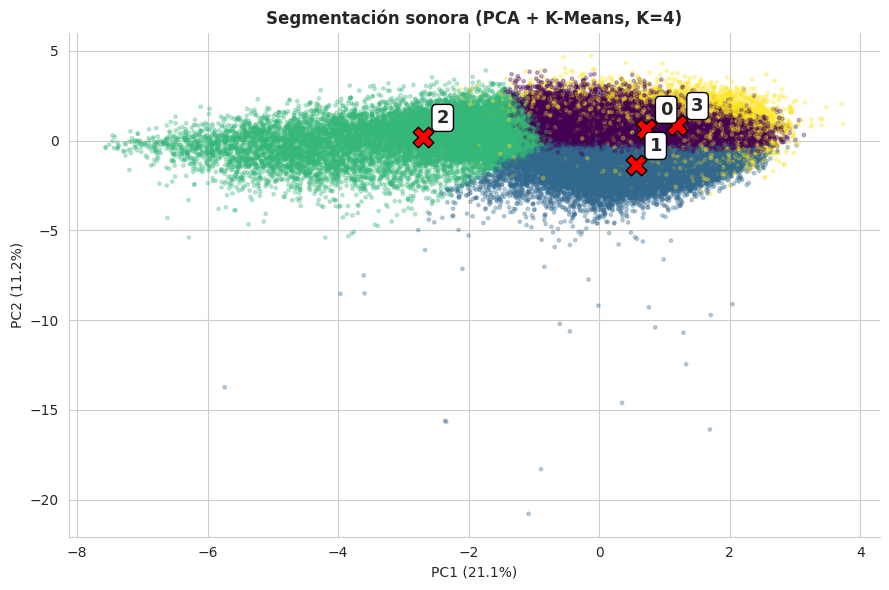

  Las tasas de hit por cluster son parecidas (0.21–0.30): **no prueban** que el modelo capte
  "calidad musical"; sirven para auditar si se descarta algún perfil sonoro. *(Conclusión reformulada según la
  retroalimentación.)*
- **Regresión de popularidad** (para los KPIs MAE/RMSE/R²): solo música R² 0.086; set de lanzamiento MAE 11.8,
  RMSE 16.8, R² 0.337 (predecir la mediana da MAE 17.3).

---

## 8. EV3 — Optimización, ensambles, generalización y selección

> Cifras de la ejecución final del notebook (`MODO_RAPIDO = False`, XGBoost 3.4.1, scikit-learn 1.6.1), con la
> regla de 1σ contra el sobreajuste ya aplicada (Sección 8.9).

### 8.0 Mapa de la rúbrica

| Indicador | Peso | Dónde |
|---|---|---|
| IE9 Optimización de hiperparámetros | 20% | 8.3, 8.6 |
| IE10 Técnicas de ensamble | 30% | 8.4 |
| IE11 Capacidad de generalización | 20% | 8.8, 8.9 |
| IE12 Selección de la solución óptima | 30% | 8.11, 8.12 |

### 8.1 Continuidad con EV2
Mismo código de carga, mismas variables (set de lanzamiento, 135 columnas), misma partición por artista y mismo
balanceo. **El test de EV3 es exactamente el de EV2 corregido.** Los KPIs de regresión usan los mismos
hiperparámetros en ambos notebooks, de modo que coinciden.

### 8.2 Protocolo de evaluación sin fuga
```
train (71.153, 14.064 artistas)
 ├── búsqueda de hiperparámetros ...... CV agrupada por artista, 3 pliegues (submuestra 30–50%)
 ├── CV K=5 agrupada por artista ...... probabilidades fuera de pliegue (OOF) → umbral, auditoría, sobreajuste
 └── modelo final (100% train)
test (17.579, 3.517 artistas nunca vistos) → se usa UNA sola vez para confirmar
```
- **Umbral elegido con OOF, no con el test.** En la ActividadML de referencia el barrido de umbral se hacía sobre
  el test, lo que sobreestima el desempeño; aquí se corrigió.
- **Selección del modelo con métricas de CV**, no del test (evita sesgo de selección).

### 8.3 IE9 — Optimización de hiperparámetros
**Método:** `RandomizedSearchCV` (los espacios de XGBoost tienen 8 hiperparámetros continuos; una grilla completa
sería inviable). **Métrica:** PR-AUC (independiente del umbral, adecuada al desbalance). **Validación:**
`StratifiedGroupKFold(3)` por artista. La configuración base de EV2 se evalúa **en los mismos pliegues**, así que
el Δ se atribuye solo a los hiperparámetros.

| Modelo | PR-AUC CV base (EV2) | Brecha base | PR-AUC CV elegida (1σ) | Brecha elegida | Δ PR-AUC | Configuraciones probadas |
|---|---|---|---|---|---|---|
| Random Forest | 0.5695 | 0.337 | 0.5785 | 0.403 | +0.0091 | 10 |
| XGBoost | 0.5958 | 0.283 | 0.5877 | **0.129** | −0.0081 | 20 (11 equivalentes a la mejor) |

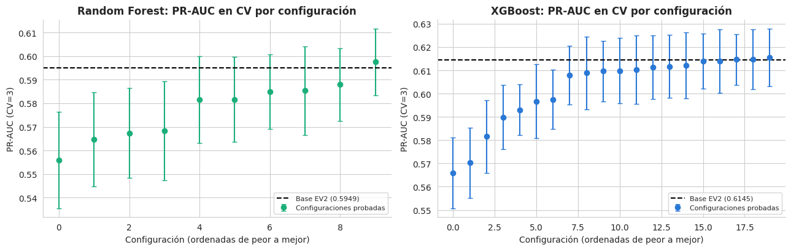
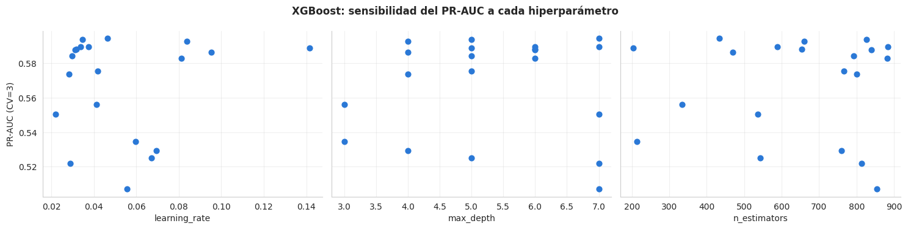

**Configuración final:** XGBoost `learning_rate` 0.031, `max_depth` 6, `n_estimators` 839, `min_child_weight` 10,
`gamma` 5, `reg_lambda` 15.6, `subsample` 0.96, `colsample_bytree` 0.84 (más regularizada que la base de EV2). Random
Forest: 300 árboles, `min_samples_leaf` 2, `max_features` log2, sin límite de profundidad.

**Lectura:** el PR-AUC prácticamente no cambia (±0.01, dentro de 1σ): el techo lo pone la información disponible,
no los hiperparámetros. Lo que sí cambia es el **sobreajuste**: en XGBoost la regla de 1σ cede 0.008 de PR-AUC a
cambio de bajar la brecha train − CV de 0.283 a 0.129. **Problema detectado antes:** al elegir solo por el máximo
PR-AUC, Random Forest seleccionaba `min_samples_leaf=1` (PR-AUC de train 0.998), es decir, la búsqueda **premiaba la
memorización**. La corrección (regla de 1σ con control de brecha) está en la Sección 8.9.

La **mayor ganancia de optimización vino del umbral** (Sección 8.6): pasar de 0.50 al umbral de negocio redujo el
Waste Rate de XGBoost de 51.8% a 47.4% en test.

### 8.4 IE10 — Técnicas de ensamble

| Técnica | Modelo | Qué problema ataca |
|---|---|---|
| Referencia | Árbol de Decisión | Mide cuánto aporta ensamblar |
| **Bagging** | Random Forest | Varianza: promedia árboles entrenados con muestras distintas |
| **Boosting** | XGBoost | Sesgo: cada árbol corrige el error del anterior, con regularización |
| **Votación suave** | RF + XGB | Combina errores poco correlacionados |

**Comparación lado a lado (test, umbral 0.50):**

| Modelo | Precision | Recall | F1 | PR-AUC | ROC-AUC | FN (hits perdidos) | FP (promoción perdida) |
|---|---|---|---|---|---|---|---|
| Árbol de Decisión | 0.671 | 0.241 | 0.355 | 0.384 | 0.632 | 3.219 | 500 |
| Regresión Logística | 0.461 | 0.779 | 0.579 | 0.572 | 0.821 | 936 | 3.871 |
| Random Forest | 0.577 | 0.569 | 0.573 | 0.620 | 0.838 | 1.828 | 1.767 |
| XGBoost | 0.482 | 0.791 | 0.599 | 0.619 | 0.842 | 887 | 3.599 |
| Votación RF+XGB | 0.540 | 0.688 | 0.605 | 0.626 | 0.843 | 1.321 | 2.491 |

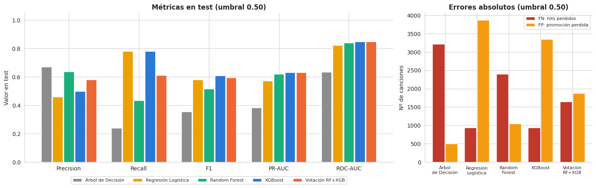
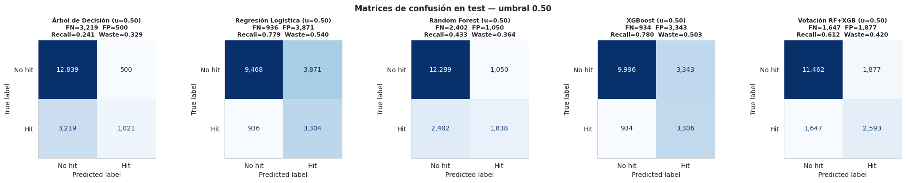

**Aporte del ensamble medido en dinero.** Como 0.50 no es un umbral de negocio, la comparación justa es: *para
descubrir el 70% de los hits, ¿qué parte del presupuesto se desperdicia?* (leído en la curva PR del test):

| Árbol | Regresión Logística | Random Forest | **XGBoost** | Votación | Azar |
|---|---|---|---|---|---|
| 74.0% | 50.4% | 47.4% | **47.1%** | 46.6% | 75.9% |

Los ensambles ahorran **~27 puntos de presupuesto** frente al árbol simple. Además, el árbol es **inestable**: su
Recall varía mucho entre pliegues de la CV (σ = 0.092, el único modelo sobre el límite de 0.05).

### 8.5 Curvas ROC y Precision-Recall

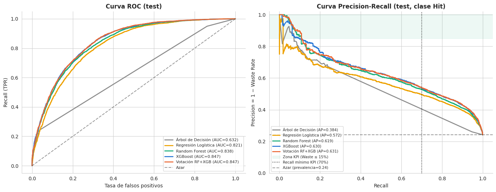

La curva PR es la relevante para el negocio: su eje Y es `1 − Waste Rate`. La zona sombreada (Waste ≤ 15%) solo se
alcanza con Recall muy bajo: esa es la prueba gráfica del conflicto entre KPIs.

### 8.6 Umbral óptimo (maximizar Recall bajo restricción)
Se compararon cuatro políticas sobre las probabilidades OOF (XGBoost):

| Política | Umbral | Recall test | Waste test | Hits perdidos | Promociones perdidas |
|---|---|---|---|---|---|
| Por defecto | 0.50 | 0.791 | 0.518 | 887 | 3.599 |
| Máx F2 (política de EV2) | 0.35 | 0.929 | 0.603 | 301 | 5.979 |
| Máx Recall con Waste ≤ 15% (meta original) | 0.92 | **0.077** | 0.145 | 3.915 | 55 |
| **Recall ≥ 70% con mínimo Waste (oficial)** | **0.55** | **0.707** | **0.474** | 1.244 | 2.702 |

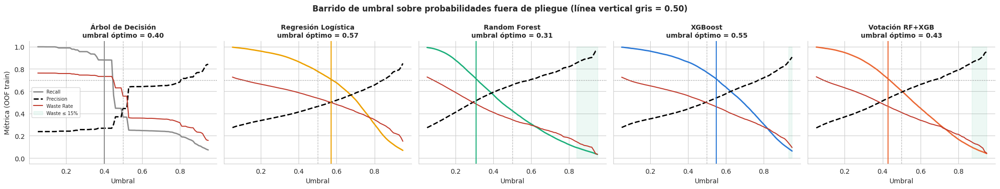
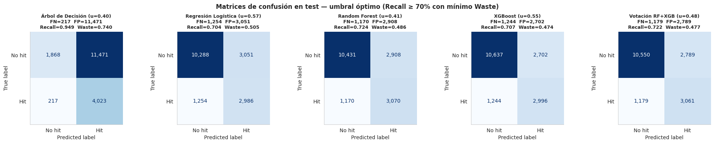

**Decisión y por qué cambió:** la primera versión de EV3 usaba "Waste ≤ 15%", pero con artistas nuevos esa regla
solo detecta el 8% de los hits: sería inútil. Se adoptó la regla de la ActividadML: **garantizar el KPI de Recall
(≥ 70%) gastando lo mínimo**. Así se cumple el KPI principal y el desperdicio queda 29 puntos bajo el azar.

### 8.7 Feature importance (RF + XGB + permutación) y ablación

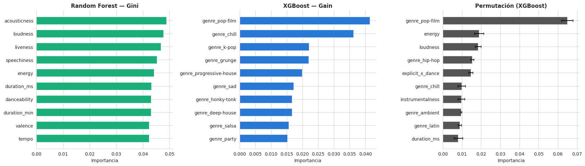

| Método | Top 3 | Sesgo del método |
|---|---|---|
| Random Forest (Gini) | acousticness, loudness, liveness | Favorece variables continuas: reparte la importancia entre las variables de audio |
| XGBoost (Gain) | genre_pop-film, genre_chill, genre_k-pop | Se concentra en pocas variables muy informativas |
| **Permutación (test)** | genre_pop-film, genre_chill, genre_hip-hop | Árbitro: mide la caída real de PR-AUC en datos no vistos |

**Importancia por bloques** (permutando bloques completos en test, XGBoost):

| Bloque | % de la importancia |
|---|---|
| **Género (114 columnas)** | **80.8%** |
| Acústicas (14) | 14.7% |
| Ingeniería (7) | 4.5% |

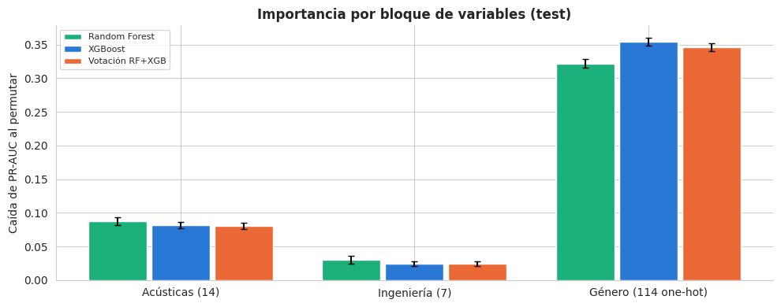

**Ablación "música vs. contexto"** (test, artistas nuevos):

| Variante | PR-AUC | R² popularidad | MAE |
|---|---|---|---|
| 1. Solo música | 0.419 | **0.086** | 15.7 |
| **2. Lanzamiento (+ género), oficial** | **0.619** | 0.337 | 11.8 |
| 3. + Catálogo (excluido) | 0.617 | 0.327 | 11.7 |
| 4. + TE artista/álbum (excluido, fuga) | 0.696 | 0.676 | 9.0 |

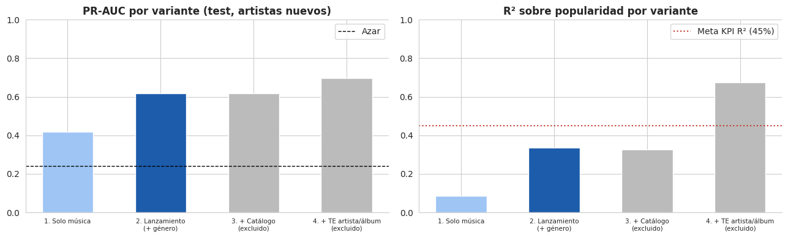

**Insight de negocio:** el modelo predice principalmente **en qué mercado compite la canción** (género), no **cómo
suena**. Traducción a acciones: el género define la estrategia de playlist y canal; el audio (energía, loudness,
duración) es una señal secundaria útil para elegir el single dentro de un mismo género.

### 8.8 IE11 — Auditoría estadística con validación cruzada K=5
`StratifiedGroupKFold(5)` agrupado por artista. Criterio de estabilidad: σ ≤ 0.05.

| Modelo | PR-AUC por pliegue | Media | σ | Recall media | σ Recall | Estabilidad |
|---|---|---|---|---|---|---|
| Árbol de Decisión | 0.391 · 0.385 · 0.392 · 0.402 · 0.397 | 0.393 | 0.006 | 0.874 | **0.092** | ⚠️ inestable |
| Regresión Logística | 0.561 · 0.587 · 0.620 · 0.614 · 0.562 | 0.589 | 0.025 | 0.709 | 0.019 | ✅ |
| Random Forest | 0.608 · 0.614 · 0.651 · 0.631 · 0.601 | 0.621 | 0.018 | 0.718 | 0.028 | ✅ |
| **XGBoost** | 0.605 · 0.624 · 0.652 · 0.628 · 0.608 | **0.623** | **0.017** | 0.709 | 0.029 | ✅ |
| Votación RF+XGB | 0.613 · 0.624 · 0.660 · 0.635 · 0.611 | 0.629 | 0.018 | 0.716 | 0.031 | ✅ |

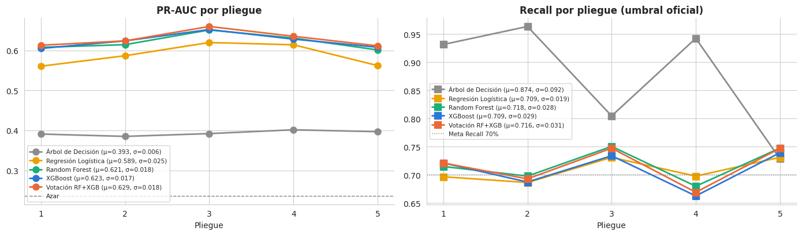

- **Votación vs. XGBoost:** la votación supera a XGBoost por +0.0052 de PR-AUC, IC 95% [+0.0009, +0.0096]: la
  diferencia es **estadísticamente distinta de 0, pero pequeña** (menos de un tercio de la σ entre pliegues). Por qué
  igual se elige XGBoost: Sección 8.11.
- **¿Cuánto inflaba la CV aleatoria?** XGBoost: 0.620 (por artista) vs 0.670 (aleatoria), **+0.050**.
- **CV vs. test:** XGBoost 0.623 vs 0.619; todos los modelos difieren menos de 0.02 → **la CV predice bien el
  desempeño en datos nunca vistos**.

### 8.9 IE11 — Diagnóstico de sobreajuste (Train vs. CV)
Criterio de la ActividadML: brecha = métrica_train − métrica_CV; ≥ 0.10 indica sobreajuste.

**Antes del ajuste** (búsqueda solo por máximo PR-AUC), XGBoost tenía brecha **0.178** y Random Forest **0.376**.
**Ajuste aplicado:** **regla de 1 desviación estándar** en la búsqueda. Entre las configuraciones cuyo PR-AUC en CV
está a menos de 1σ de la mejor (estadísticamente equivalentes), se elige la de **menor brecha train − CV**, con
espacios que incluyen regularización fuerte (`max_depth`, `min_samples_leaf` en RF; `min_child_weight`, `gamma`,
`reg_lambda` en XGB).

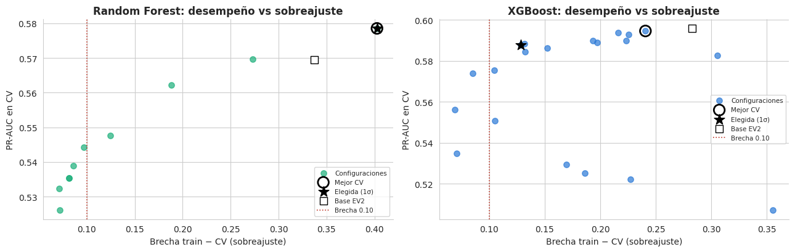

**Resultado final (modelos entrenados con el 100% de train, CV K=5):**

| Modelo | PR-AUC train | PR-AUC CV | Brecha | Diagnóstico |
|---|---|---|---|---|
| Árbol de Decisión | 0.458 | 0.393 | 0.064 | ✅ |
| Regresión Logística | 0.615 | 0.589 | 0.027 | ✅ |
| Random Forest | 0.969 | 0.621 | **0.348** | ⚠️ |
| **XGBoost** | 0.713 | 0.623 | **0.090** | ✅ |
| Votación RF+XGB | 0.887 | 0.629 | 0.258 | ⚠️ |

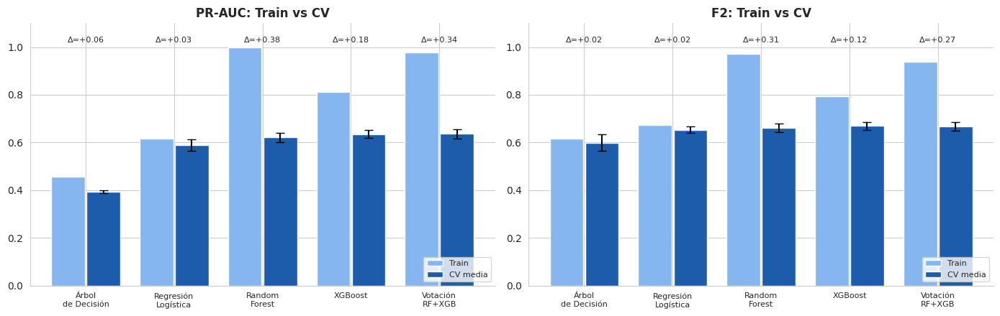
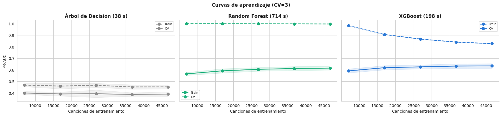

**Efecto del ajuste:** la brecha de XGBoost baja de **0.178 a 0.090 (✅ bajo el límite de 0.10)** con PR-AUC en CV
prácticamente igual. Las curvas de aprendizaje muestran que su brecha además **se cierra** con más datos (0.128 →
0.096). Random Forest no tenía configuraciones regularizadas dentro de 1σ (las regularizadas perdían demasiado
PR-AUC) y sigue con brecha alta: RF memoriza por diseño, pero su CV y su test coinciden (0.621 vs 0.620), es decir,
generaliza. La votación hereda ese sobreajuste.

**Otro hallazgo de medición:** en una versión intermedia que aún usaba Target Encoding, hasta la Regresión
Logística mostraba PR-AUC de train ≈ 0.99. Era una **auto-fuga del encoder** (al transformar filas de train usaba la
etiqueta de la propia canción), no memorización. Se corrigió midiendo el train sobre la codificación cruzada y fue
una segunda razón para retirar el TE.

### 8.10 Sesgos y equidad con evidencia

**Equidad por grupo de géneros** (recall al umbral de negocio, XGBoost):

| Grupo de géneros (por tasa de hit en train) | Tasa de hit real | Recall OOF | Recall test |
|---|---|---|---|
| Nicho | 3.5% | 0.033 | **0.035** |
| Intermedio | 20.6% | 0.355 | 0.371 |
| Mainstream | 52.3% | 0.914 | **0.927** |

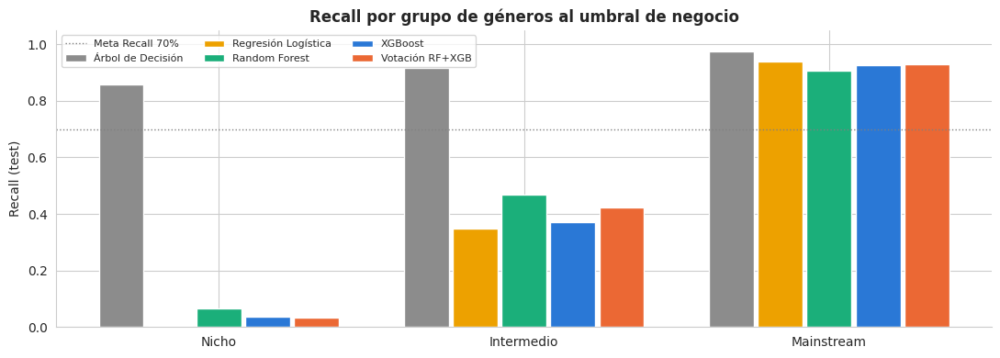

> **Hallazgo crítico:** de cada 100 hits de géneros de nicho, el modelo detecta 4. Un hit de salsa o tango
> prácticamente nunca sería promocionado. Es el sesgo de **homogeneización cultural** hecho número.

**Artistas emergentes vs. establecidos** (XGBoost, test):

| Catálogo del artista | Tasa de hit real | Recall | Waste Rate |
|---|---|---|---|
| 1 canción | 29.1% | 0.726 | 0.441 |
| 2–10 canciones | 25.8% | 0.719 | 0.439 |
| > 10 canciones | 22.1% | 0.692 | 0.508 |

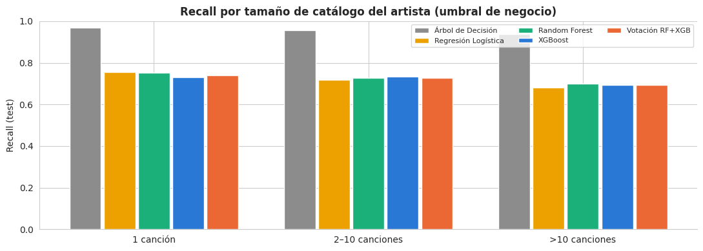

No se subestima a los emergentes: el sesgo relevante es por **género**, no por tamaño del artista.

**Segmentos sonoros (K-Means de EV2):** recall entre 0.66 (electrónica/metal de alta energía) y 0.83 (bailable de
alta energía). El perfil sonoro afecta menos que el género.

**Diversidad de la lista promocionada y mitigación aplicada:**

| | Géneros en el top-200 | Género dominante | Precisión del top-200 |
|---|---|---|---|
| Ranking original | 8 | 47% | 0.960 |
| **Re-ranking con cupo 10% por género** | **21** | ≤ 10% | 0.885 |

Ganar 13 géneros cuesta 7.5 puntos de precisión: es un *trade-off* explícito y barato.

**Calibración:** la probabilidad media predicha (0.41) supera la tasa real (0.24) porque `scale_pos_weight` infla la
clase hit. Las probabilidades sirven para **ordenar**, no para decir "esta canción tiene 70% de probabilidad".

### 8.11 IE12 — Selección y justificación de la solución óptima
**Matriz de decisión** construida **solo con métricas de CV** (sin mirar el test):

| Criterio | Peso | Justificación |
|---|---|---|
| Precisión a Recall 70% (1 − Waste) | 0.30 | Con el recall fijado, gana quien desperdicia menos |
| PR-AUC | 0.25 | Calidad del ranking, robusta a cambios de presupuesto |
| Equidad (recall nicho/mainstream) | 0.15 | No amplificar la homogeneización cultural |
| Estabilidad (σ) | 0.10 | Generalización certificable |
| Generalización (−brecha) | 0.10 | Penaliza sobreajuste |
| Interpretabilidad | 0.05 | Auditabilidad ante artistas y regulación |
| Costo de infraestructura | 0.05 | Operación y reentrenamiento |

| Modelo | Precisión CV | PR-AUC CV | σ | Equidad | Brecha | Puntaje |
|---|---|---|---|---|---|---|
| **XGBoost** | **0.528** | 0.623 | 0.017 | 0.036 | 0.090 | **0.720** |
| Regresión Logística | 0.500 | 0.589 | 0.025 | 0.016 | 0.027 | 0.675 |
| Votación RF+XGB | 0.525 | 0.629 | 0.018 | 0.050 | 0.258 | 0.618 |
| Random Forest | 0.515 | 0.621 | 0.018 | 0.084 | 0.348 | 0.601 |
| Árbol de Decisión | 0.271 | 0.393 | 0.006 | 0.807 | 0.064 | 0.438 |

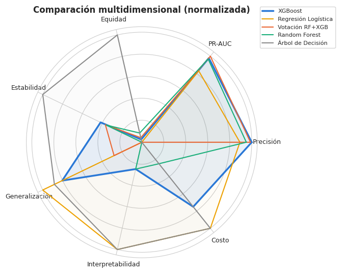

**Análisis de sensibilidad:** XGBoost gana con pesos oficiales y con foco comercial; con foco ético o pesos iguales
gana el árbol, porque predice "hit" para casi todo (equidad alta, pero desperdicia 74%). **Interpretación:** si el
negocio prioriza desempeño, XGBoost; el árbol no es una alternativa operativa real.

**Por qué XGBoost y no la Votación:** la votación tiene un PR-AUC levemente mayor (+0.005, estadísticamente distinto
de 0), pero esa ventaja no se traduce en negocio: a Recall 70% desperdicia casi lo mismo (CV: 47.5% vs 47.2%;
test: 47.7% vs 47.4%). A cambio, entrena dos modelos (≈6× más tiempo: 100 s vs 16 s), hereda el sobreajuste de RF
(brecha 0.258 vs 0.090) y es menos interpretable. **Una mejora de 0.005 no justifica el doble de modelo y el triple
de sobreajuste.**

**Párrafo ejecutivo (generado por el notebook):**
> Se recomienda desplegar XGBoost como motor de priorización de lanzamientos. En validación cruzada de 5 pliegues
> alcanza PR-AUC = 0.623 (±0.017) y, con un umbral de 0.55 que garantiza descubrir al menos el 70% de los hits,
> desperdicia 47.2% del presupuesto frente al 76% de promocionar al azar. En el test (artistas nunca vistos) confirma
> Recall = 0.707, Waste Rate = 0.474 y PR-AUC = 0.619; para descubrir el 70% de los hits desperdicia 27.0% menos
> presupuesto que el árbol simple. Su principal limitación es que la música explica poco del éxito y que favorece a
> los géneros que la plataforma ya premia: debe usarse como señal complementaria, con cupos de diversidad, cuota para
> artistas emergentes y revisión humana.

### 8.12 Qué representan las métricas del modelo elegido

| Métrica | Valor | Para el negocio |
|---|---|---|
| Recall | 0.707 | Descubre 71 de cada 100 éxitos |
| Precision | 0.526 | 53 de cada 100 promociones aciertan |
| Waste Rate | 0.474 | Se pierde el 47% del presupuesto promocional (azar: 76%) |
| PR-AUC | 0.619 | La lista de candidatos es 2.6× mejor que elegir al azar |
| ROC-AUC | 0.842 | En 84% de los pares hit/no-hit, el hit recibe mayor puntaje |
| F2 | 0.661 | Balance que pesa doble no perder hits |
| NDCG@20 | 0.668 | Orden aceptable dentro de una playlist, no excelente |
| σ entre pliegues | 0.017 | El desempeño no depende de la muestra |

---

## 9. Registro de errores, ajustes y decisiones

| # | Etapa | Problema detectado | Evidencia | Decisión / corrección | Impacto |
|---|---|---|---|---|---|
| 1 | EV1 | Canciones repetidas por género | `track_id` repetidos | Agrupar por `track_id` + multietiqueta | 114.000 → 88.732 filas |
| 2 | EV2 | SMOTE crea canciones imposibles en el one-hot | F1 estancado en 0.57–0.59 | `class_weight` / `scale_pos_weight` | Sin datos sintéticos inválidos |
| 3 | EV2 | **Fuga por TE de álbum y split aleatorio** | Retroalimentación EP2; ablación | Split por artista; sin TE; pipeline | PR-AUC 0.85 → 0.62 (honesto) |
| 4 | EV2 | 8.309 canciones repetidas con otro `track_id` | Conteo nombre + artista | Cubierto por el split por artista | Sin copias entre train y test |
| 5 | EV2 | TE de artista no sirve con artistas nuevos | −0.030 PR-AUC en ablación | Excluido | Modelo coherente con el caso real |
| 6 | EV2 | Catálogo del artista no aporta y premia a los grandes | +0.003 PR-AUC | Excluido; solo para auditoría | Menos efecto Mateo |
| 7 | EV2 | Mejor modelo elegido mirando el test | Revisión | Selección en validación | Sin sesgo de selección |
| 8 | EV2 | **Error de código:** el modelo final compartía objeto con el de validación | XGBoost: val 0.649 → test 0.506 | `clone()` para cada pipeline | XGBoost test 0.506 → 0.623 |
| 9 | EV2 | Afirmación "se subestima a emergentes" sin cifras | Retroalimentación EP2 | Medido por tamaño de catálogo | Hipótesis rechazada con datos |
| 10 | EV2 | Conclusión fuerte sobre clusters | Hit rate 0.21–0.30 | Reformulada con cautela | Coherencia con la evidencia |
| 11 | EV2 | KPIs del inicio distintos a los verificados; MAE nunca calculado | Retroalimentación EP2 | Tabla única + modelo de regresión | Trazabilidad KPI → código |
| 12 | EV2/EV3 | Rutas relativas a la carpeta actual | Retroalimentación EP2 | Función `ubicar()` (`../data/`) | Reproducible en local y Colab |
| 13 | EV3 | Umbral elegido con el test (ActividadML) | Revisión metodológica | Umbral con OOF; test una vez | Estimación honesta |
| 14 | EV3 | Auto-fuga del TE en métricas de train | LR con PR-AUC train ≈ 0.99 | Train medido sobre codificación cruzada | Diagnóstico de sobreajuste real |
| 15 | EV3 | Política Waste ≤ 15% inútil sin fuga | Recall máximo 0.08 | Recall ≥ 70% con mínimo Waste | KPI principal cumplido |
| 16 | EV3 | Comparar modelos solo con su umbral puede ser injusto (probabilidades escalonadas del árbol) | Árbol: σ Recall 0.092 entre pliegues | Comparar además por Waste a Recall 70% en la curva PR | Comparación justa entre modelos |
| 17 | EV3 | **Búsqueda premiaba la memorización** | RF `min_samples_leaf=1`, brecha 0.38 | Regla de 1σ + espacios regularizados | XGBoost brecha 0.178 → 0.090 |
| 18 | EV3 | KPIs de regresión distintos entre EV2 y EV3 | R² 0.090 vs 0.098 | Mismas variables e hiperparámetros | Cifras idénticas en ambos notebooks |
| 19 | EV3 | El entorno se cerraba tras ~1 hora | Reinicio del kernel | Puntos de guardado (`cacheado`) + menos iteraciones | Reanudable; 2.ª ejecución en segundos |
| 20 | EV3 | Explicación incorrecta de la fuga del álbum ("los compilados delatan el éxito") | Compilados con tasa de hit 0 | Redacción corregida: la popularidad es homogénea dentro del álbum | Explicación fiel a los datos |
| 21 | EV3 | Top-200 concentrado en 8 géneros | Diversity 8 < 15 | Re-ranking con cupo 10% | 21 géneros, −7.5 pts de precisión |

---

## 10. Sesgos del modelo: evidencia, mitigación, impacto y precauciones

| Sesgo | Evidencia | Qué hicimos | Impacto si no se controla | Precaución en producción |
|---|---|---|---|---|
| **Fuga de información** | CV aleatoria +0.05 PR-AUC; TE álbum +0.08 | Split y CV por artista; sin TE; umbral con OOF | Presupuesto decidido con un modelo mucho peor de lo que se cree | Validar siempre con artistas/períodos no vistos; no usar variables posteriores al lanzamiento |
| **Efecto Mateo** | Música sola R² 0.09; género 81% de la importancia | Ablación y declaración explícita | Se promociona lo que ya era popular; profecía autocumplida | Usar como apoyo, no como filtro; cuota para artistas sin historial |
| **Homogeneización por género** | Recall nicho 0.04 vs mainstream 0.93 | Equidad como criterio de la matriz; re-ranking con cupo | Catálogo cada vez más uniforme; nicho invisible | Cupo por género en la lista final; reportar el ratio en cada iteración |
| **Artistas emergentes** | Recall 0.73 (1 canción) vs 0.69 (>10) | Sin TE ni catálogo como variables | Hoy controlado; reaparecería si se agrega historial del artista | Monitorear recall por tamaño de catálogo |
| **Conflicto de KPIs** | Waste ≤ 15% ⇒ Recall 0.08 | Política explícita y tabla de alternativas | Con umbral 0.50 se desperdiciaría 52% | Documentar el umbral como decisión de negocio; recalcularlo si cambia el presupuesto |
| **Calibración** | Prob. media 0.41 vs tasa real 0.24 | Uso del umbral, no de la probabilidad cruda | Decisiones con probabilidades sobreestimadas | Calibrar (Platt/isotónica) si se necesitan probabilidades |
| **Recencia y muestreo** | ~1.000 canciones por género; popularidad reciente | Declarado como limitación | Catálogo histórico subvalorado | Agregar fecha de lanzamiento; reentrenar periódicamente |
| **Manipulación** | *Stream farming* puede inflar la popularidad | Declarado | Modelo reentrenado con datos contaminados | Auditar anomalías de reproducciones antes de reentrenar |

---

## 11. Ética, privacidad y marco normativo

- **Datos personales:** el dataset no contiene información personal de oyentes. Nombres de artistas, canciones y
  álbumes son públicos (propiedad intelectual).
- **Ley 19.628 (Chile) y RGPD (UE):** regulan la recolección de los datos de consumo con los que Spotify calcula la
  popularidad (consentimiento, finalidad, minimización).
- **EU AI Act:** un sistema que influye en la inversión que reciben los artistas exige transparencia, gobernanza de
  datos y mitigación de sesgos. Por eso el modelo se documenta como **apoyo a la decisión**, con criterios auditables.
- **Riesgos éticos:** invisibilización de géneros de nicho y artistas emergentes; homogeneización sonora si todos los
  sellos usan modelos similares; opacidad para los artistas; manipulación por granjas de reproducciones.
- **Pregunta de la defensa EP2: ¿cómo dar más peso a artistas que invierten en publicidad?** Opciones: (1)
  `sample_weight` al entrenar; (2) una variable de campaña o presupuesto; (3) un umbral distinto para ese segmento;
  (4) re-ordenar la lista final con `probabilidad × valor del artista`. **Riesgo:** todas amplifican el efecto Mateo;
  la opción 4 es la más segura porque no altera el modelo y es reversible, y debe ir acompañada de una cuota protegida
  para artistas sin historial.

---

## 12. Viabilidad financiera (simulación)

**Resultado:** si cada promoción costara $500.000 CLP, conseguir los mismos 2.996 hits cuesta **$2.849 millones con el
modelo y $6.211 millones al azar**: un ahorro de **$3.362 millones (54%)** y un costo por hit **2,2 veces menor**.

> ⚠️ **Escenario hipotético.** El dataset no trae costos de promoción. Los $500.000 por canción son un valor de
> ejemplo para traducir las métricas a dinero. El supuesto clave es que todas las promociones cuestan lo mismo.

### 12.1 Dato base

Toda la simulación sale de la matriz de confusión de XGBoost (umbral 0.55) en la prueba final: 17.579 canciones de
3.517 artistas que el modelo nunca vio (EV3, comparación en test al umbral óptimo).

| | Promocionada (predicho hit) | No promocionada | Total |
|---|---|---|---|
| **Real hit** | TP = 2.996 | FN = 1.244 | 4.240 |
| **Real no hit** | FP = 2.702 | TN = 10.637 | 13.339 |
| **Total** | 5.698 | 11.881 | 17.579 |

### 12.2 KPIs de negocio (sin dinero)

| KPI | Fórmula | Cálculo | Resultado |
|---|---|---|---|
| Tasa de acierto de la promoción | TP / (TP + FP) | 2.996 / 5.698 | **52,6%** (azar: 24,1%) |
| Rendimiento vs azar (lift) | precisión / prevalencia | 0,526 / 0,241 | **2,2×** |
| Promociones por hit | (TP + FP) / TP | 5.698 / 2.996 | **1,9** (azar: 4,1) |
| Promociones fallidas | FP / (TP + FP) | 2.702 / 5.698 | **47,4%** (azar: 75,9%; −28 pts) |
| Foco del catálogo | (TP + FP) / total y TP / (TP + FN) | 5.698 / 17.579; 2.996 / 4.240 | **32% del catálogo capta 71% de los hits** |
| Oportunidades perdidas | FN / (TP + FN) | 1.244 / 4.240 | **1.244 hits (29,3%)** |

### 12.3 Simulación con $500.000 por promoción

| Escenario: lograr 2.996 hits | Con XGBoost | Al azar | Cálculo |
|---|---|---|---|
| Promociones necesarias | 5.698 | 12.421 | Modelo: TP + FP · Azar: 2.996 / 0,2412 |
| Inversión total | $2.849 millones | $6.211 millones | Promociones × $500.000 |
| Inversión en canciones que no fueron hit | $1.351 millones | $4.713 millones | Promociones fallidas × $500.000 |
| Costo por hit conseguido | $951.000 | $2.073.000 | Inversión total / 2.996 |
| **Ahorro** | **$3.362 millones (54%)** | — | Diferencia de inversión total |

**Con presupuesto fijo:** $100 millones alcanzan para 200 promociones; con el modelo resultan ~105 hits y al azar ~48.

### 12.4 Sensibilidad y lectura

- Si cambia el costo por promoción, los montos cambian en la misma proporción, pero el **ahorro relativo (54%)** y la
  **relación de costo por hit (2,2×)** no cambian: dependen solo de la matriz de confusión.
- Si las promociones tuvieran costos distintos por canción, habría que ponderar cada FP y TP por su costo real.
- La simulación no incluye el costo de los 1.244 hits perdidos (ingresos no capturados) ni el costo de operar el
  modelo, que es bajo frente a la inversión en marketing.
- **Conclusión:** el modelo es financieramente viable como priorizador: con la misma inversión se obtiene más del
  doble de hits. La decisión final debe incluir el cupo por género y la revisión humana (Sección 13).

---

## 13. Conclusiones, limitaciones y recomendaciones para el negocio

### Conclusiones
1. **Una métrica alta no es un buen modelo si hay fuga.** El PR-AUC bajó de 0.85 a 0.62 al evaluar como en la vida
   real; la cifra honesta es la única útil para decidir presupuesto.
2. **El éxito en Spotify depende más del mercado que del sonido.** La música explica ~9% de la popularidad; el
   género, 81% de la capacidad predictiva.
3. **Los ensambles aportan valor medible:** para detectar el 70% de los hits, XGBoost desperdicia 47% del presupuesto
   frente a 74% del árbol simple y 76% del azar.
4. **La optimización más rentable fue el umbral**, no los hiperparámetros; y la optimización de hiperparámetros
   aportó sobre todo **generalización** (menor sobreajuste) con el mismo desempeño.
5. **El modelo es estable y generaliza** (σ = 0.017; CV y test coinciden), pero **no es neutral**: casi no detecta
   hits de géneros de nicho.

### Limitaciones
- Faltan variables de contexto: seguidores, sello, playlists editoriales, fecha de lanzamiento, inversión en marketing.
- `popularity` mide consumo reciente de la plataforma, no calidad ni valor de catálogo.
- El dataset es una muestra de ~1.000 canciones por género, no representa el catálogo real.
- Géneros de nicho con 0–3 hits en test no permiten métricas individuales estables (se agruparon en terciles).
- Probabilidades no calibradas.
- Búsqueda de hiperparámetros con iteraciones acotadas por costo computacional.

### Recomendaciones para el sello
1. **Usar XGBoost como priorizador**, con decisión final humana (A&R).
2. **Umbral documentado** (Recall ≥ 70% con mínimo desperdicio); recalcularlo si cambia el presupuesto, sin reentrenar.
3. **Re-ranking con cupo por género** (máx. 10%) en la lista final.
4. **Cuota protegida (~20%)** del presupuesto para artistas sin historial y géneros de nicho.
5. **Redefinir las metas de KPI** respecto del azar y de una línea base honesta.
6. **Monitorear** en cada iteración: recall por género, por tamaño de catálogo y diversidad del top-200.
7. **Recolectar datos de campañas** para separar el efecto marketing del efecto música; reentrenar periódicamente.

### Líneas futuras
Embeddings de audio preentrenados (CLAP, OpenL3), calibración de probabilidades, stacking con meta-modelo, umbrales
por grupo de género, grafos de colaboración entre artistas y evaluación contrafactual del efecto de la promoción.

---

## 14. Anexos

### A. Diccionario de datos
| Variable | Descripción |
|---|---|
| `track_id` | ID de Spotify de la pista |
| `artists` | Artistas que interpretan la pista; si hay varios, separados por `;` |
| `album_name` | Álbum en el que aparece la pista |
| `track_name` | Nombre de la pista |
| `popularity` | 0–100, calculada por Spotify según número y recencia de reproducciones. Las versiones duplicadas (single y álbum) se valoran por separado |
| `duration_ms` | Duración en milisegundos |
| `explicit` | Letra explícita (verdadero/falso) |
| `danceability` | 0–1, qué tan bailable es (tempo, estabilidad del ritmo, fuerza del compás) |
| `energy` | 0–1, intensidad y actividad percibidas |
| `key` | Tonalidad (0 = C, 1 = C♯/D♭, …; −1 si no se detecta) |
| `loudness` | Sonoridad general en dB |
| `mode` | Modalidad: 1 mayor, 0 menor |
| `speechiness` | 0–1, presencia de palabra hablada (> 0.66 casi solo habla) |
| `acousticness` | 0–1, confianza de que la pista es acústica |
| `instrumentalness` | 0–1, probabilidad de que no tenga voz |
| `liveness` | 0–1, presencia de público (> 0.8, probablemente en vivo) |
| `valence` | 0–1, positividad musical |
| `tempo` | Tempo estimado en BPM |
| `time_signature` | Compás estimado (3 a 7) |
| `track_genre` | Género (en el dataset limpio: 114 columnas binarias `genre_*`) |
| **Derivadas** | `duration_min`, `is_short` (< 3 min), `is_long` (> 5 min), `n_artists`, `energy_x_dance`, `valence_x_energy`, `explicit_x_dance`; `artist_primary` y `artist_n_tracks` solo para partición y auditoría |

### B. Glosario de métricas
- **Fuga de datos (data leakage):** uso, durante el entrenamiento o la evaluación, de información que no estará
  disponible al predecir en la realidad.
- **PR-AUC (Average Precision):** calidad del ranking para la clase hit; su valor de referencia es la prevalencia.
- **Recall / Precision / Waste Rate:** hits detectados / promociones acertadas / 1 − Precision.
- **F2:** media ponderada de precision y recall que da el doble de peso al recall.
- **OOF (out-of-fold):** predicción de cada canción hecha por un modelo que no la vio al entrenar.
- **Validación cruzada agrupada:** pliegues en que un mismo artista nunca está en entrenamiento y validación a la vez.
- **Brecha train − CV:** diferencia de desempeño entre datos vistos y no vistos; mide sobreajuste.
- **Regla de 1σ:** entre modelos estadísticamente equivalentes al mejor, elegir el más simple o regularizado.

### C. Figuras
Todas las figuras están en `images/`, con un prefijo por etapa:
- `images/ev1_*.png`: figuras de EV1 (8), extraídas del notebook `ev1_ML_EDA_JohanSotoFernandaAlcaino.ipynb`.
- `images/ev2_*.png`: figuras de EV2 corregido (5).
- `images/ev3_*.png`: figuras de EV3 (17).

Todas provienen de las salidas de los notebooks ejecutados. Al volver a ejecutar, EV2 y EV3 regeneran sus figuras
en `images/` (en Colab: `/content/images/`).

---

*Notebooks: `ev1_ML_EDA_JohanSotoFernandaAlcaino.ipynb`, `ev2_ML_Modelo_JohanSotoFernandaAlcaino.ipynb`, `ev3_ML_Optimizacion_JohanSotoFernandaAlcaino.ipynb`.*
