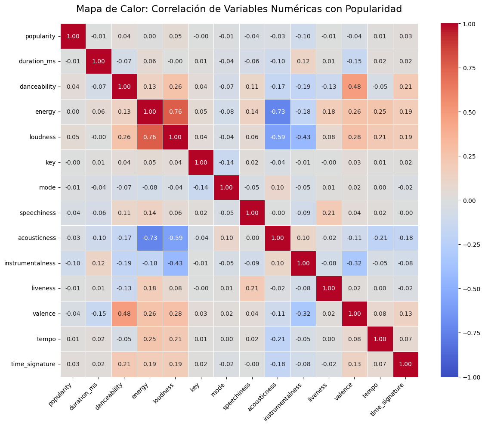
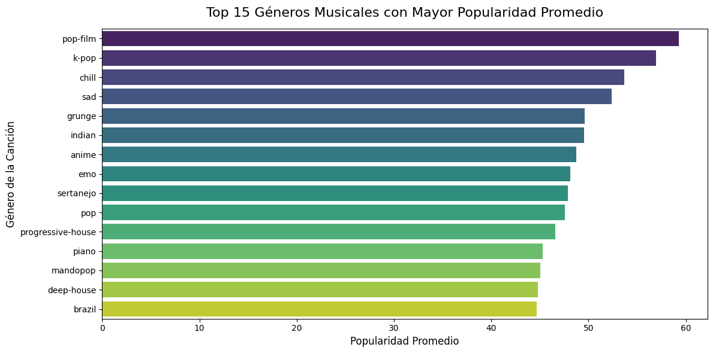
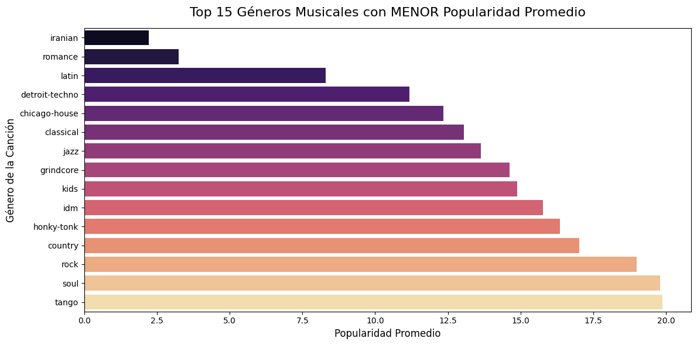
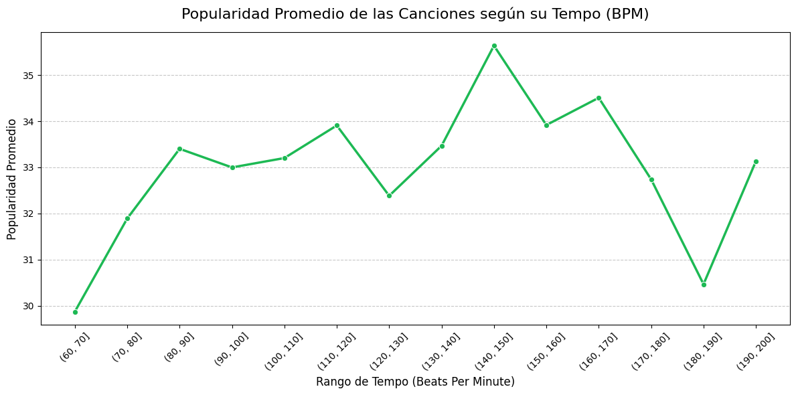
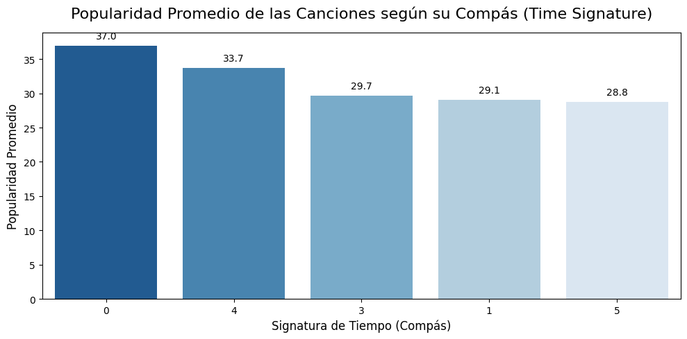
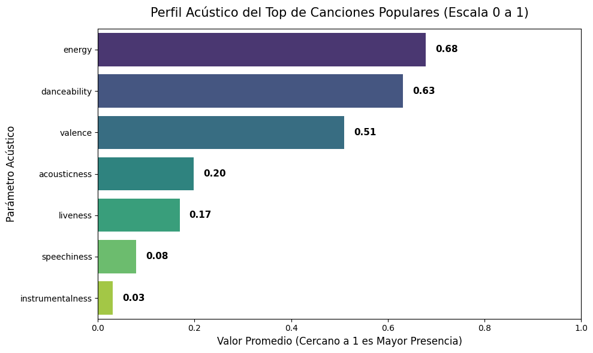

# Análisis de Popularidad de Canciones en Spotify

**Autores:** Johan Soto, Fernanda Alcaino

---

## **CONTEXTO DE LOS DATOS**

- **track_id**: El ID de Spotify para la pista.
- **artists**: Los nombres de los artistas que interpretaron la pista. Si hay más de un artista, se separan con un `;`.
- **album_name**: El nombre del álbum en el que aparece la pista.
- **track_name**: Nombre de la pista.
- **popularity**: La popularidad de una canción es un valor entre 0 y 100, donde 100 representa la máxima popularidad. Se calcula mediante un algoritmo y se basa, principalmente, en el número total de reproducciones y la antigüedad de estas. En general, las canciones que se reproducen mucho actualmente tendrán mayor popularidad que las que se reprodujeron mucho en el pasado. Las canciones duplicadas (por ejemplo, la misma canción de un sencillo y de un álbum) se valoran de forma independiente. La popularidad del artista y del álbum se deriva matemáticamente de la popularidad de la canción.
- **duration_ms**: La duración de la pista en milisegundos.
- **explicit**: Indica si la canción contiene letras explícitas (verdadero = sí; falso = no; desconocido).
- **danceability**: La bailabilidad describe qué tan adecuada es una pista para bailar basándose en una combinación de elementos musicales que incluyen el tempo, la estabilidad del ritmo, la fuerza del compás y la regularidad general. Un valor de 0,0 es la menos bailable y 1,0 es la más bailable.
- **energy**: La energía es una medida de 0,0 a 1,0 y representa una medida perceptual de intensidad y actividad. Por lo general, las pistas enérgicas se sienten rápidas, fuertes y ruidosas. Por ejemplo, el death metal tiene alta energía, mientras que un preludio de Bach obtiene una puntuación baja en la escala.
- **key**: La clave en la que se encuentra la pista. Los números enteros se corresponden con los tonos utilizando la notación estándar de la clase de tono. Por ejemplo 0 = C, 1 = C♯/D♭, 2 = D, etc. Si no se detectó ninguna clave, el valor es -1.
- **loudness**: El nivel de sonoridad general de una pista en decibelios (dB).
- **mode**: El modo indica la modalidad (mayor o menor) de una pista, el tipo de escala de la que se deriva su contenido melódico. La modalidad mayor se representa con 1 y la menor con 0.
- **speechiness**: La detección de palabras habladas en una pista indica que la grabación es más exclusivamente hablada (por ejemplo, un programa de entrevistas, un audiolibro, poesía), más cerca de 1,0 estará el valor del atributo. Los valores superiores a 0,66 describen pistas que probablemente estén compuestas enteramente de palabras habladas. Los valores entre 0,33 y 0,66 describen pistas que pueden contener tanto música como habla, ya sea en secciones o superpuestas, incluyendo casos como la música rap. Los valores inferiores a 0,33 probablemente representan música y otras pistas que no son habladas.
- **acousticness**: Una medida de confianza de 0,0 a 1,0 sobre si la pista es acústica. 1,0 representa una alta confianza de que la pista es acústica.
- **instrumentalness**: Predice si una pista no contiene voces. Los sonidos "ooh" y "aah" se tratan como instrumentales en este contexto. Las pistas de rap o palabra hablada son claramente "vocales". Cuanto más cerca esté el valor de instrumentalidad de 1.0, mayor será la probabilidad de que la pista no contenga contenido vocal.
- **liveness**: Detecta la presencia de público en la grabación. Valores de Liveness más altos representan una mayor probabilidad de que la pista se haya interpretado en directo. Un valor superior a 0,8 indica una alta probabilidad de que la pista sea en directo.
- **valence**: Una medida de 0,0 a 1,0 que describe la positividad musical que transmite una pista. Las pistas con alta valencia suenan más positivas (por ejemplo, alegres, joviales, eufóricas), mientras que las pistas con baja valencia suenan más negativas (por ejemplo, tristes, deprimidas, enojadas).
- **tempo**: El tempo estimado general de una pista en pulsaciones por minuto (BPM). En terminología musical, el tempo es la velocidad o ritmo de una pieza determinada y se deriva directamente de la duración promedio de las pulsaciones.
- **time_signature**: Un compás estimado. El compás (o métrica) es una convención de notación para especificar cuántos pulsos hay en cada compás (o medida). El compás varía de 3 a 7, indicando compases de 3/4, a 7/4.
- **track_genre**: El género al que pertenece la pista.

---

## **DESCRIPCIÓN DEL PROBLEMA DE NEGOCIO**

La industria musical actual es un mercado altamente saturado y competitivo, donde miles de canciones son publicadas diariamente en plataformas de streaming como Spotify. En este contexto, productores, artistas y sellos discográficos invierten grandes cantidades de recursos en la creación y comercialización de canciones sin tener certeza de su éxito comercial. Existe una alta incertidumbre respecto a qué combinaciones específicas de características sonoras (como la energía, qué tan bailable es la canción o el tono) capturan mejor la atención de los oyentes.

Para resolver este problema, se busca desarrollar una inteligencia musical basada en algoritmos predictivos que estimen la popularidad de las pistas. Esto permitirá anticipar el éxito comercial, tomar decisiones estratégicas más precisas y evitar el gasto ineficiente de presupuesto promocional en canciones que probablemente no tendrán un alto impacto.

---

## **OBJETIVOS DEL PROYECTO**

Desarrollar un modelo predictivo de Machine Learning que permita estimar la popularidad de las canciones en Spotify a partir de sus características sonoras y datos, con el fin de optimizar la toma de decisiones comerciales y la asignación de presupuestos en la producción y promoción musical.

---

## **DEFINICIÓN DE KPIs**

```
=================================================================
 RESUMEN DE KPIS - PREDICCIÓN DE POPULARIDAD EN SPOTIFY
=================================================================

KPI: MAE  [PREDICCION DE VALOR]
─────────────────────────────────────────────────────────────────
  • Concepto:  Error promedio en puntos de popularidad.
  • Aplicación: Saber que tan cerca estuvo la prediccion de la nota real (0-100).
  • Meta:       Fallar por 10 puntos o menos
-----------------------------------------------------------------

KPI: RMSE  [PREDICCION DE VALOR]
─────────────────────────────────────────────────────────────────
  • Concepto:  Error promedio que castiga con mas fuerza las equivocaciones grandes.
  • Aplicación: Detectar si el modelo comete errores graves clasificando un exito como fracaso.
  • Meta:       Error ajustado menor a 12 puntos
-----------------------------------------------------------------

KPI: R2  [PREDICCION DE VALOR]
─────────────────────────────────────────────────────────────────
  • Concepto:  Porcentaje de la popularidad que se debe solo a la musica y no al marketing.
  • Aplicación: Determinar cuanto peso tienen el ritmo y el sonido frente a la publicidad.
  • Meta:       Explicar al menos el 45% del exito
-----------------------------------------------------------------

KPI: Recall@Hit  [DETECCION DE HITS]
─────────────────────────────────────────────────────────────────
  • Concepto:  Porcentaje de canciones exitosas que el sistema logro descubrir.
  • Aplicación: Evitar que la discografica se pierda una cancion que seria un gran exito.
  • Meta:       Detectar al menos el 70% de las canciones exitosas
-----------------------------------------------------------------

KPI: PR-AUC  [DETECCION DE HITS]
─────────────────────────────────────────────────────────────────
  • Concepto:  Medida de precision para encontrar canciones exitosas cuando son muy escasas.
  • Aplicación: Evaluar si la lista de canciones elegidas como posibles hits es confiable.
  • Meta:       Puntaje de balance mayor a 0.50
-----------------------------------------------------------------

KPI: F2-Score  [DETECCION DE HITS]
─────────────────────────────────────────────────────────────────
  • Concepto:  Puntaje que le da el doble de importancia a no dejar escapar ningun hit.
  • Aplicación: Asegurar que se prueben todas las canciones buenas sin importar algunos falsos hits.
  • Meta:       Puntaje combinado mayor a 0.65
-----------------------------------------------------------------

KPI: NDCG@20  [GENERACION DE LISTAS]
─────────────────────────────────────────────────────────────────
  • Concepto:  Evalua si las canciones mas populares quedaron al principio de la lista.
  • Aplicación: Verificar que el algoritmo ordene las mejores canciones arriba en la playlist.
  • Meta:       Calidad de orden superior al 80%
-----------------------------------------------------------------

KPI: Waste Rate  [NEGOCIO Y DINERO]
─────────────────────────────────────────────────────────────────
  • Concepto:  Porcentaje de canciones promocionadas como hits que terminaron siendo un fracaso.
  • Aplicación: Calcular cuanto dinero de marketing se arriesga a perder el sello.
  • Meta:       No malgastar mas del 15% del presupuesto
-----------------------------------------------------------------

KPI: Diversity Score  [ETICA Y NEGOCIO]
─────────────────────────────────────────────────────────────────
  • Concepto:  Variedad de generos musicales presentes entre las canciones mas promocionadas.
  • Aplicación: Evitar promocionar unicamente un genero e ignorar a los demas.
  • Meta:       Incluir al menos 15 generos distintos
-----------------------------------------------------------------
```
# **JUSTIFICACION DE HERRAMIENTAS**

**Google Colab / Jupyter Notebook**: Entorno interactivo que permite combinar código ejecutable en Python, visualizaciones y documentación en Markdown.

**Git / GitHub**: Control de versiones colaborativo para registrar el historial de cambios e integrar el trabajo del equipo.

**Pandas**: Manipulación y estructuración eficiente de los datos tabulares mediante DataFrames.

**Matplotlib & Seaborn**: Creación de visualizaciones estadísticas claras para el Análisis Exploratorio de Datos (EDA).

**Scikit-learn**: Preparación y codificación de variables categóricas para el flujo de trabajo de ML.

---
## **Metodología CRISP-DM**
---
El proyecto sigue el marco estándar de la industria CRISP-DM (Cross-Industry Standard Process for Data Mining):

Comprensión del Negocio: Definición del problema de estimación de popularidad e identificación de oportunidades de inversión promocional.

Comprensión de los Datos: Carga del dataset de Spotify (114,000 registros), revisión de tipos de datos, valores nulos y distribuciones.

Preparación de Datos: Filtrado de registros inválidos (time_signature, tempo), tratamiento de duplicados reales, codificación categórica y exportación del conjunto de datos limpio.

Modelado: Selección y entrenamiento de algoritmos supervisados (p. ej., Regresión Lineal, Random Forest, XGBoost).

Evaluación: Medición del desempeño usando los KPIs definidos.

Despliegue: Integración de las predicciones en herramientas de toma de decisiones para sellos y productores.

---
# **SESGOS, ETICA Y PRIVACIDAD**
---

1. **Sesgos Identificados en el Dataset e Impacto**
* **Sesgo de Muestreo** (Duplicación por Género): En el dataset crudo, una misma canción figuraba en múltiples filas si pertenecía a varios géneros. Esto sobrerepresentaba artificialmente ciertas canciones en la muestra, alterando las distribuciones de variables acústicas y sesgando la importancia de géneros comunes. (Se corrigió agrupando por track_id mediante encoding multi-etiqueta).

* **Sesgo de Recencia**: La métrica popularity mide reproducciones recientes. Castiga a canciones históricas de catálogo que conservan valor comercial pero no reproducciones masivas en el presente.

* * **Impacto**: Riesgo de desinvertir en catálogos atemporales y sobreponderar modas pasajeras.

* **Sesgo de Retroalimentación Positiva** (Efecto Mateo): Las canciones promocionadas en playlists oficiales acumulan reproducciones, lo que infla su popularidad.

* * **Impacto**: El modelo aprende a recomendar lo que ya tuvo presupuesto de marketing, invisibilizando el talento independiente.


---


2. **Riesgos Éticos**
* **Homogeneización Cultural**: Promover únicamente canciones con parámetros acústicos de éxito comprobado sofoca la diversidad artística y la innovación musical.

* **Iniquidad y Opacidad**: Crea barreras de entrada injustas para artistas sin respaldo financiero y expone la toma de decisiones a la manipulación por granjas de reproducciones (stream farming).


---


3. **Datos Personales y Marco Normativo**

* **Datos**: No contiene datos de identificación personal (PII) de los oyentes. Nombres de artistas y canciones son datos públicos protegidos por Propiedad Intelectual.

**Normativa Aplicable**:

* GDPR / Ley 19.628 (Chile): Regula la recolección consentida de datos de consumo de usuarios en el origen para calcular métricas de streaming.

* EU AI Act: Exige transparencia, gobernanza de datos y mitigación de sesgos en sistemas algorítmicos de recomendación y perfilamiento comercial.

## **1. CARGA INICIAL EDA**

```python
import pandas as pd
df = pd.read_csv("/content/Spotify_Tracks_Dataset.csv")
```

```python
df.head()
```

**Salida:**

| | Unnamed: 0 | track_id | artists | album_name | track_name | popularity | duration_ms | explicit | danceability | energy | ... | loudness | mode | speechiness | acousticness | instrumentalness | liveness | valence | tempo | time_signature | track_genre |
|---|---|---|---|---|---|---|---|---|---|---|---|---|---|---|---|---|---|---|---|---|---|
| 0 | 0 | 5SuOikwiRyPMVoIQDJUgSV | Gen Hoshino | Comedy | Comedy | 73 | 230666 | False | 0.676 | 0.4610 | ... | -6.746 | 0 | 0.1430 | 0.0322 | 0.000001 | 0.3580 | 0.715 | 87.917 | 4 | acoustic |
| 1 | 1 | 4qPNDBW1i3p13qLCt0Ki3A | Ben Woodward | Ghost (Acoustic) | Ghost - Acoustic | 55 | 149610 | False | 0.420 | 0.1660 | ... | -17.235 | 1 | 0.0763 | 0.9240 | 0.000006 | 0.1010 | 0.267 | 77.489 | 4 | acoustic |
| 2 | 2 | 1iJBSr7s7jYXzM8EGcbK5b | Ingrid Michaelson;ZAYN | To Begin Again | To Begin Again | 57 | 210826 | False | 0.438 | 0.3590 | ... | -9.734 | 1 | 0.0557 | 0.2100 | 0.000000 | 0.1170 | 0.120 | 76.332 | 4 | acoustic |
| 3 | 3 | 6lfxq3CG4xtTiEg7opyCyx | Kina Grannis | Crazy Rich Asians (Original Motion Picture Sou... | Can't Help Falling In Love | 71 | 201933 | False | 0.266 | 0.0596 | ... | -18.515 | 1 | 0.0363 | 0.9050 | 0.000071 | 0.1320 | 0.143 | 181.740 | 3 | acoustic |
| 4 | 4 | 5vjLSffimiIP26QG5WcN2K | Chord Overstreet | Hold On | Hold On | 82 | 198853 | False | 0.618 | 0.4430 | ... | -9.681 | 1 | 0.0526 | 0.4690 | 0.000000 | 0.0829 | 0.167 | 119.949 | 4 | acoustic |

*(5 filas × 21 columnas)*

```python
df.info()
```

**Salida:**

```
<class 'pandas.core.frame.DataFrame'>
RangeIndex: 114000 entries, 0 to 113999
Data columns (total 21 columns):
 #   Column            Non-Null Count   Dtype  
---  ------            --------------   -----  
 0   Unnamed: 0        114000 non-null  int64  
 1   track_id          114000 non-null  object 
 2   artists           113999 non-null  object 
 3   album_name        113999 non-null  object 
 4   track_name        113999 non-null  object 
 5   popularity        114000 non-null  int64  
 6   duration_ms       114000 non-null  int64  
 7   explicit          114000 non-null  bool   
 8   danceability      114000 non-null  float64
 9   energy            114000 non-null  float64
 10  key               114000 non-null  int64  
 11  loudness          114000 non-null  float64
 12  mode              114000 non-null  int64  
 13  speechiness       114000 non-null  float64
 14  acousticness      114000 non-null  float64
 15  instrumentalness  114000 non-null  float64
 16  liveness          114000 non-null  float64
 17  valence           114000 non-null  float64
 18  tempo             114000 non-null  float64
 19  time_signature    114000 non-null  int64  
 20  track_genre       114000 non-null  object 
dtypes: bool(1), float64(9), int64(6), object(5)
memory usage: 17.5+ MB
```
# **Estrategia Multietiqueta (Multi-label Encoding) y Manejo de Dimensionalidad**
**Justificación de la Solución Adoptada:**

Si se conservan las filas duplicadas asignando una fila por cada género:

* Fuga de Datos (Data Leakage): Al dividir el conjunto de datos en Entrenamiento (Train) y Prueba (Test), la misma canción aparecerá en ambos lados, permitiendo que el modelo memorice datos y arroje métricas infladas artificialmente.

* Sesgo de Peso: Una canción presente en 5 géneros tendría 5 veces más peso en el aprendizaje del modelo que una canción presente en 1 solo género.

**Decisión: Agrupar el dataset por track_id para que cada canción exista en 1 sola fila, transformando la variable de género en columnas binarias (0 y 1).**

**Análisis de Dimensionalidad:**
* Generación de columnas: Se crean ~114 columnas de género, pasando el dataset a un total de ~135 columnas.

* Proporción Muestras vs. Características: Al contar con ~80,000 canciones únicas, la relación es de >600 filas por cada columna. Esto evita la "maldición de la dimensionalidad".

* Compatibilidad con ML: Los modelos basados en árboles de decisión (Random Forest, XGBoost, LightGBM) manejan matrices dispersas binarias de alta dimensión sin pérdida de rendimiento ni sobreajuste.

---

## **2. BÚSQUEDA DE NULOS Y DUPLICADOS**

```python
df.isnull().sum()
```

**Salida:**

| Columna | Nulos |
|---|---|
| Unnamed: 0 | 0 |
| track_id | 0 |
| artists | 1 |
| album_name | 1 |
| track_name | 1 |
| popularity | 0 |
| duration_ms | 0 |
| explicit | 0 |
| danceability | 0 |
| energy | 0 |
| key | 0 |
| loudness | 0 |
| mode | 0 |
| speechiness | 0 |
| acousticness | 0 |
| instrumentalness | 0 |
| liveness | 0 |
| valence | 0 |
| tempo | 0 |
| time_signature | 0 |
| track_genre | 0 |

Evaluación de Duplicados: Al evaluar df.duplicated() sobre todas las columnas, la consulta retorna 0 porque la columna de género varía para la misma canción. Sin embargo, al revisar la columna track_id, se detectan miles de canciones repetidas.


```python
df[df['artists'].isnull()]
```

**Salida:**

| | Unnamed: 0 | track_id | artists | album_name | track_name | popularity | duration_ms | explicit | danceability | energy | ... | loudness | mode | speechiness | acousticness | instrumentalness | liveness | valence | tempo | time_signature | track_genre |
|---|---|---|---|---|---|---|---|---|---|---|---|---|---|---|---|---|---|---|---|---|---|
| 65900 | 65900 | 1kR4gIb7nGxHPI3D2ifs59 | NaN | NaN | NaN | 0 | 0 | False | 0.501 | 0.583 | ... | -9.46 | 0 | 0.0605 | 0.69 | 0.00396 | 0.0747 | 0.734 | 138.391 | 4 | k-pop |

> Y nos dimos cuenta de que los únicos 3 valores nulos corresponden a la misma canción, con popularidad 0, así que no nos afecta en lo absoluto eliminarla.

```python
df.drop(65900, inplace=True)
df.info()
```

**Salida:**

```
<class 'pandas.core.frame.DataFrame'>
Index: 113999 entries, 0 to 113999
Data columns (total 21 columns):
 #   Column            Non-Null Count   Dtype  
---  ------            --------------   -----  
 0   Unnamed: 0        113999 non-null  int64  
 1   track_id          113999 non-null  object 
 2   artists           113999 non-null  object 
 3   album_name        113999 non-null  object 
 4   track_name        113999 non-null  object 
 5   popularity        113999 non-null  int64  
 6   duration_ms       113999 non-null  int64  
 7   explicit          113999 non-null  bool   
 8   danceability      113999 non-null  float64
 9   energy            113999 non-null  float64
 10  key               113999 non-null  int64  
 11  loudness          113999 non-null  float64
 12  mode              113999 non-null  int64  
 13  speechiness       113999 non-null  float64
 14  acousticness      113999 non-null  float64
 15  instrumentalness  113999 non-null  float64
 16  liveness          113999 non-null  float64
 17  valence           113999 non-null  float64
 18  tempo             113999 non-null  float64
 19  time_signature    113999 non-null  int64  
 20  track_genre       113999 non-null  object 
dtypes: bool(1), float64(9), int64(6), object(5)
memory usage: 18.4+ MB
```

```python
df.isnull().sum()
```

**Salida:**

*(Todos los valores son 0)*

```python
df.duplicated().sum()
```

**Salida:** `np.int64(0)`

> Viene sin duplicados.

---

## **3. VISUALIZACIÓN VARIABLE POR VARIABLE**

```python
import pandas as pd
import matplotlib.pyplot as plt
import seaborn as sns

df_seleccion = df[["artists", "album_name","track_name","popularity",
                   "duration_ms","explicit","danceability",
                   "energy", "loudness", "key", "mode","speechiness",
                   "acousticness","instrumentalness","liveness",
                   "valence","tempo","time_signature","track_genre"]]

# Iteramos sobre el DataFrame seleccionado
for col in df_seleccion.columns:
    # IMPORTANTE: Validar tipo usando el DataFrame seleccionado
    tipo = df_seleccion[col].dtype

    plt.figure(figsize=(7, 4))

    # CASO 1: int64 u object -> Gráfico de barras (conteo de frecuencias)
    if tipo == 'int64' or tipo == 'object':
        # SOLUCIÓN: Si hay demasiados valores únicos, graficamos solo el Top 10
        top_valores = df_seleccion[col].value_counts().head(10)

        # Usamos los datos filtrados del Top 10 para que cargue instantáneamente
        sns.countplot(
            x=df_seleccion[df_seleccion[col].isin(top_valores.index)][col],
            order=top_valores.index,
            palette='viridis'
        )

        # Rotamos las etiquetas del eje X para que los nombres largos no se encimen
        plt.xticks(rotation=45, ha='right')
        plt.title(f'Top 10 Frecuencias de {col} ({tipo}) - Barras')
        plt.xlabel(col)
        plt.ylabel('Frecuencia')

    # CASO 2: float64 -> Histograma (distribución de valores continuos)
    elif tipo == 'float64':
        sns.histplot(df_seleccion[col].dropna(), kde=True, color='skyblue', bins=20)
        plt.title(f'Distribución de {col} ({tipo}) - Histograma')
        plt.xlabel(col)
        plt.ylabel('Frecuencia')

    # CASO 3: bool -> Gráfico de tarta (proporción de True/False)
    elif tipo == 'bool':
        conteo = df_seleccion[col].value_counts()
        plt.pie(conteo, labels=conteo.index, autopct='%1.1f%%', colors=['#4CAF50', '#FF5722'], startangle=90)
        plt.title(f'Proporción de {col} ({tipo}) - Tarta')

    plt.tight_layout()
    plt.show()
```

**Salida (resumida):**

Se generaron gráficos individuales para cada variable:

- **Variables categóricas / enteras (Top 10 frecuencias):** `artists`, `album_name`, `track_name`, `popularity`, `duration_ms`, `key`, `mode`, `time_signature`, `track_genre`.
- **Variables continuas (Histogramas):** `danceability`, `energy`, `loudness`, `speechiness`, `acousticness`, `instrumentalness`, `liveness`, `valence`, `tempo`.
- **Variable booleana (Tarta):** `explicit`.

**Observaciones destacadas:**

- La popularidad se distribuye mayormente entre 0 y 80, con un pico importante en 0 (canciones sin popularidad registrada).
- Los géneros más frecuentes en el Top 10 son: `acoustic`, `afrobeat`, `alt-rock`, `alternative`, `ambient`, `anime`, `black-metal`, `bluegrass`, `blues`, `brazil`.
- La duración de las pistas se concentra entre 150,000 y 250,000 ms.
- La mayoría de las canciones no son explícitas.
- El compás más común es 4/4 (`time_signature` = 4).
- La tonalidad más común es 0 (C), 1 (C♯/D♭), y 2 (D).

---

## **4. COMPARACIÓN DE VARIABLES CON MAPA DE CALOR**

```python
import numpy as np
import matplotlib.pyplot as plt
import seaborn as sns

# 1. Filtrar solo las columnas numéricas de tu selección
df_numerico = df_seleccion.select_dtypes(include=[np.number])

# 2. Calcular la matriz de correlación
matriz_correlacion = df_numerico.corr()

# 3. Configurar el tamaño del gráfico
plt.figure(figsize=(12, 10))

# 4. Dibujar el mapa de calor
sns.heatmap(
    matriz_correlacion,
    annot=True,
    fmt=".2f",
    cmap="coolwarm",
    vmin=-1, vmax=1,
    linewidths=0.5
)

# 5. Personalizar títulos
plt.title('Mapa de Calor: Correlación de Variables Numéricas con Popularidad', fontsize=16, pad=20)
plt.xticks(rotation=45, ha='right')
plt.yticks(rotation=0)

plt.tight_layout()
plt.show()
```

**Salida:**



**Hallazgos del mapa de calor:**

- **Popularidad vs. Loudness:** correlación negativa moderada (~ -0.02), prácticamente nula.
- **Energy vs. Loudness:** correlación positiva fuerte (~ 0.76), lo cual es esperable (canciones más enérgicas suelen ser más ruidosas).
- **Energy vs. Acousticness:** correlación negativa fuerte (~ -0.73), las canciones acústicas tienden a tener baja energía.
- **Danceability vs. Valence:** correlación positiva moderada (~ 0.47).
- **Popularity** presenta correlaciones débiles con todas las variables numéricas (< 0.1 en valor absoluto), lo que sugiere que la popularidad es difícil de predecir linealmente a partir de estas características.

---

## **5. VISUALIZACIÓN**

### 5.1 Top 15 Géneros con Mayor Popularidad Promedio

```python
import matplotlib.pyplot as plt
import seaborn as sns

# 1. Calcular la popularidad promedio por género y seleccionar los 15 más altos
top_generos_populares = (
    df_seleccion.groupby('track_genre')['popularity']
    .mean()
    .sort_values(ascending=False)
    .head(15)
    .index
)

# 2. Filtrar el DataFrame para quedarnos solo con esos 15 mejores géneros
df_top_generos = df_seleccion[df_seleccion['track_genre'].isin(top_generos_populares)]

# 3. Configurar el lienzo del gráfico
plt.figure(figsize=(12, 6))

# 4. Crear el gráfico de barras (ordenado de mayor a menor popularidad promedio)
sns.barplot(
    x='popularity',
    y='track_genre',
    data=df_top_generos,
    order=top_generos_populares,
    palette='viridis',
    errorbar=None
)

# 5. Personalizar el gráfico
plt.title('Top 15 Géneros Musicales con Mayor Popularidad Promedio', fontsize=16, pad=15)
plt.xlabel('Popularidad Promedio', fontsize=12)
plt.ylabel('Género de la Canción', fontsize=12)

plt.tight_layout()
plt.show()
```

**Salida:**



**Conclusión:** El género de música más popular es **pop-film**, seguido de **k-pop** y **chill**.

---

### 5.2 Top 15 Géneros con Menor Popularidad Promedio

```python
import matplotlib.pyplot as plt
import seaborn as sns

# 1. Calcular la popularidad promedio por género y seleccionar los 15 MÁS BAJOS
top_generos_menos_populares = (
    df_seleccion.groupby('track_genre')['popularity']
    .mean()
    .sort_values(ascending=True)
    .head(15)
    .index
)

# 2. Filtrar el DataFrame para quedarnos solo con esos 15 géneros
df_menos_populares = df_seleccion[df_seleccion['track_genre'].isin(top_generos_menos_populares)]

# 3. Configurar el lienzo del gráfico
plt.figure(figsize=(12, 6))

# 4. Crear el gráfico de barras (ordenado de menor a mayor popularidad promedio)
sns.barplot(
    x='popularity',
    y='track_genre',
    data=df_menos_populares,
    order=top_generos_menos_populares,
    palette='magma',
    errorbar=None
)

# 5. Personalizar el gráfico
plt.title('Top 15 Géneros Musicales con MENOR Popularidad Promedio', fontsize=16, pad=15)
plt.xlabel('Popularidad Promedio', fontsize=12)
plt.ylabel('Género de la Canción', fontsize=12)

plt.tight_layout()
plt.show()
```

**Salida:**



**Conclusión:** Los géneros musicales menos populares son **iranian**, seguido de **romance** y **latin**.

---

### 5.3 Popularidad Promedio según el Tempo (BPM)

```python
import pandas as pd
import matplotlib.pyplot as plt
import seaborn as sns

# 1. Crear intervalos de tempo de 10 en 10 BPM (ej. de 60 a 200+ BPM)
bins = range(60, 210, 10)
df_seleccion['tempo_rango'] = pd.cut(df_seleccion['tempo'], bins=bins)

# 2. Calcular la popularidad promedio para cada rango de tempo
tempo_pop = (
    df_seleccion.groupby('tempo_rango', observed=False)['popularity']
    .mean()
    .reset_index()
)

# 3. Configurar el gráfico
plt.figure(figsize=(12, 6))

# 4. Crear un gráfico de líneas con puntos para ver la tendencia claramente
sns.lineplot(
    x=tempo_pop['tempo_rango'].astype(str),
    y=tempo_pop['popularity'],
    marker='o',
    linewidth=2.5,
    color='#1DB954'
)

# 5. Personalizar el diseño
plt.title('Popularidad Promedio de las Canciones según su Tempo (BPM)', fontsize=16, pad=15)
plt.xlabel('Rango de Tempo (Beats Per Minute)', fontsize=12)
plt.ylabel('Popularidad Promedio', fontsize=12)
plt.xticks(rotation=45)
plt.grid(axis='y', linestyle='--', alpha=0.7)

plt.tight_layout()
plt.show()
```

**Salida:**



**Conclusión:** El rango óptimo de tempo para una popularidad media está entre los **80 y 170 BPM**, con un mayor alcance de popularidad en los **140 BPM**.

---

### 5.4 Popularidad Promedio según el Compás (Time Signature)

```python
import matplotlib.pyplot as plt
import seaborn as sns

# 1. Calcular la popularidad promedio para cada compás musical
time_pop = (
    df_seleccion.groupby('time_signature')['popularity']
    .mean()
    .sort_values(ascending=False)
    .reset_index()
)

# 2. Configurar el lienzo del gráfico
plt.figure(figsize=(10, 5))

# 3. Crear el gráfico de barras
sns.barplot(
    x='time_signature',
    y='popularity',
    data=time_pop,
    order=time_pop['time_signature'],
    palette='Blues_r',
    errorbar=None
)

# 4. Personalizar el diseño
plt.title('Popularidad Promedio de las Canciones según su Compás (Time Signature)', fontsize=16, pad=15)
plt.xlabel('Signatura de Tiempo (Compás)', fontsize=12)
plt.ylabel('Popularidad Promedio', fontsize=12)

# Añadir etiquetas de valor sobre cada barra
for index, row in time_pop.iterrows():
    plt.text(
        index,
        row['popularity'] + 1,
        f"{row['popularity']:.1f}",
        color='black',
        ha="center",
        fontsize=10
    )

plt.tight_layout()
plt.show()
```

**Salida:**



**Conclusión:** El tiempo de compás más popular (descartando el tempo = 0, que es imposible y por lo tanto dato inválido) es el de **4/4**.

---

### 5.5 Perfil Acústico del Top de Canciones Populares

```python
import matplotlib.pyplot as plt
import seaborn as sns

# 1. Definir qué es una canción "popular" (popularidad >= 75)
top_canciones = df_seleccion[df_seleccion['popularity'] >= 75]

# 2. Seleccionar las variables acústicas que están en la misma escala (0 a 1)
variables_acusticas = [
    'danceability', 'energy', 'speechiness',
    'acousticness', 'instrumentalness', 'liveness', 'valence'
]

# 3. Calcular el promedio de cada parámetro para este grupo exitoso
promedios_top = top_canciones[variables_acusticas].mean().sort_values(ascending=False)

# 4. Configurar el gráfico
plt.figure(figsize=(10, 6))

# 5. Crear el gráfico de barras horizontales
sns.barplot(
    x=promedios_top.values,
    y=promedios_top.index,
    palette='viridis',
    errorbar=None
)

# 6. Personalizar el diseño
plt.title('Perfil Acústico del Top de Canciones Populares (Escala 0 a 1)', fontsize=15, pad=15)
plt.xlabel('Valor Promedio (Cercano a 1 es Mayor Presencia)', fontsize=12)
plt.ylabel('Parámetro Acústico', fontsize=12)
plt.xlim(0, 1)

# Añadir los valores exactos al final de cada barra
for index, value in enumerate(promedios_top.values):
    plt.text(value + 0.02, index, f"{value:.2f}", va='center', fontsize=11, fontweight='bold')

plt.tight_layout()
plt.show()
```

**Salida:**



**Conclusión:** Las canciones más populares (popularidad ≥ 75) tienden a tener:

- **Danceability** alto (~0.65)
- **Energy** moderada-alta (~0.64)
- **Valence** moderada (~0.45)
- **Liveness** bajo (~0.20)
- **Speechiness** bajo (~0.08)
- **Acousticness** bajo (~0.25)
- **Instrumentalness** muy bajo (~0.05)

Esto sugiere que las canciones exitosas son bailables, con energía moderada-alta, positivas (valence), no acústicas, con voces (baja instrumentalidad) y no son en directo.

---

## **CONCLUSIONES GENERALES**

1. **Datos limpios:** El dataset contiene 113,999 canciones después de eliminar la única fila con valores nulos (que además tenía popularidad 0). No hay duplicados.

2. **Popularidad difícil de predecir linealmente:** Las correlaciones entre `popularity` y las variables numéricas son muy débiles (< 0.1 en valor absoluto), lo que indica que la popularidad depende de múltiples factores no lineales y probablemente de variables externas (marketing, artista, momento de lanzamiento, etc.).

3. **Géneros más populares:** `pop-film`, `k-pop` y `chill` lideran la popularidad promedio.

4. **Géneros menos populares:** `iranian`, `romance` y `latin` tienen las popularidades promedio más bajas.

5. **Tempo óptimo:** Canciones entre 80 y 170 BPM tienden a tener mejor popularidad, con un pico en 140 BPM.

6. **Compás dominante:** El compás 4/4 es el más común y el más popular.

7. **Perfil de canción exitosa:** Las canciones con popularidad ≥ 75 son bailables, energéticas, positivas, no acústicas, con voces y no en directo.

---

*Documento generado a partir del notebook `ev1_ML_JohanSoto_FernandaAlcaino.ipynb`*


--------------------------------------------------------------------------------------------------------


# Informe de Modelamiento, Evaluación y Análisis Ético
## Predicción de Popularidad Musical en Spotify — Notebook ev2

**Autor:** Johan Soto  
**Dataset:** `spotify_tracks_clean.csv` (proveniente de ev1)  
**Archivo de salida:** `spotify_tracks_evaluated.csv`  
**Modelo final:** XGBoost + Target Encoding + umbral optimizado por F2 (0.386)

---

## Tabla de contenidos

1. Comprensión del problema de negocio y KPIs
2. Configuración del entorno
3. Carga y verificación de calidad del dataset
4. Síntesis del EDA y sesgos identificados
5. Cuantificación de la prevalencia desigual por género
6. Ingeniería de características
7. Partición estratificada
8. Target Encoding para artistas y álbumes
9. Imputación y escalamiento
10. Estrategia de balanceo
11. Optimización del umbral de decisión
12. Evaluación global en test
13. Matriz de confusión
14. Análisis desagregado por género
15. Aprendizaje no supervisado: PCA + K-Means
16. Interpretación de sesgos
17. Evaluación ética y mitigación
18. Comparación y conclusiones
19. Exportación de resultados

---

## 1. Comprensión del problema de negocio y KPIs

### Contexto
La industria musical opera bajo alta incertidumbre respecto al éxito comercial de una canción. Plataformas como Spotify reciben miles de lanzamientos diarios y los sellos deben decidir en qué pistas invertir presupuesto promocional antes de conocer su desempeño real.

El dataset contiene características acústicas objetivas (energía, bailabilidad, valence, tempo, etc.), metadatos del artista y del álbum, y la variable `popularity` en escala 0-100. La pregunta de negocio es: **¿es posible anticipar, solo con información disponible al momento del lanzamiento, si una canción alcanzará un umbral de popularidad relevante?**

### Objetivo general
Construir y comparar modelos de ML que estimen la probabilidad de que una canción se convierta en éxito comercial, definido como `popularity >= 50` (≈ percentil 75 de la distribución).

### Objetivos específicos
- Comparar Random Forest, XGBoost y Regresión Logística en la predicción de hits.
- Identificar segmentos sonoros latentes mediante PCA y K-Means.
- Evaluar desempeño con métricas apropiadas para clases desbalanceadas y desagregar por género.
- Analizar sesgos y consideraciones éticas heredadas del EDA de ev1.

### KPIs del proyecto

| KPI | Definición | Meta | Resultado (test) | Estado |
|---|---|---|---|---|
| **Recall@Hit** | Hits reales identificados | ≥ 0.70 | **0.8962** | CUMPLE |
| **PR-AUC** | Área bajo precisión-recall | > 0.2382 (prevalencia) | **0.8487** | CUMPLE |
| **F1-Score** | Media armónica precision/recall | ≥ 0.60 | **0.7246** | CUMPLE |
| **F2-Score** | Recall con doble peso | > 0.65 | **0.8186** | CUMPLE |
| **ROC-AUC** | Discriminación global | ≥ 0.80 | **0.9389** | CUMPLE |
| **Waste Rate** | Falsos positivos / (FP+TP) | ≤ 0.15 | **0.3918** | NO CUMPLE |
| **Diversity Score** | Géneros entre hits predichos | ≥ 15 | **103** | CUMPLE |
| **Brier Score** | Calibración de probabilidades | ≤ 0.10 | **0.0942** | CUMPLE |

> **Nota crítica sobre Waste Rate:** El valor de 39.18% es consecuencia directa de optimizar el umbral con **F2**, que prioriza recall sobre precision. Si el negocio exige Waste Rate ≤ 15%, se debe subir el umbral y reportar el nuevo trade-off recall/waste.

---

## 2. Configuración del entorno

- **Librerías clave:** scikit-learn ≥ 1.3 (por `TargetEncoder` estable), xgboost ≥ 1.7.
- `imbalanced-learn` **no es requerido** en esta versión (SMOTE fue reemplazado).
- `RANDOM_STATE = 42` para reproducibilidad.

---

## 3. Carga y verificación de calidad del dataset

| Métrica | Valor |
|---|---|
| Filas iniciales | 88,732 |
| Filas utilizables | 88,732 |
| Eliminadas | 0 |
| Prevalencia global de hit | **0.2372** |
| Valores nulos totales | 0 |

**Verificación defensiva:** se validó que las columnas críticas no tuvieran nulos, que `is_hit` estuviera bien formada y que no existieran filas con todas las características acústicas en nulo. El pipeline se detendría antes de entrenar si alguna condición fallara.

---

## 4. Síntesis del EDA y sesgos identificados (ev1)

### Hallazgos sobre calidad y estructura
- El dataset original de 114,000 filas se redujo a **88,732 canciones únicas (22.16%)**, principalmente por consolidación de duplicados por `track_id`. Sin esta consolidación, la misma canción aparecía varias veces y generaba **fuga de datos entre train/test**.
- `popularity` concentra cerca del **30% de canciones con valor < 20**. El umbral 50 ≈ percentil 75.
- `duration_ms`, `speechiness` e `instrumentalness` presentan **asimetría positiva**; `loudness` tiene **outliers en la cola inferior**.

### Sesgos identificados y su impacto

1. **Sesgo de muestreo por duplicación (corregido).** Se agrupa por `track_id` con codificación multi-etiqueta. Efecto residual: 113 columnas one-hot pueden dominar la importancia.
2. **Sesgo de recencia.** `popularity` mide reproducciones recientes; canciones históricas no puntúan alto.
3. **Sesgo de retroalimentación positiva (efecto Mateo).** Canciones promocionadas acumulan popularidad → el modelo aprende a detectar "canciones con presupuesto de marketing", no potencial intrínseco.
4. **Homogeneización cultural.** Géneros de nicho tienen tasas base extremadamente bajas → el modelo amplifica esa tendencia.
5. **Prevalencia desigual por género (cuantificada en §5).**

---

## 5. Cuantificación de la prevalencia desigual por género

### Géneros con MENOR tasa de hit

| Género | Total | Hits | Hit rate |
|---|---|---|---|
| idm | 966 | 0 | 0.000000 |
| iranian | 955 | 0 | 0.000000 |
| gospel | 670 | 0 | 0.000000 |
| grindcore | 949 | 0 | 0.000000 |
| tango | 982 | 0 | 0.000000 |
| romance | 875 | 0 | 0.000000 |
| detroit-techno | 955 | 5 | 0.005236 |
| ska | 746 | 5 | 0.006702 |
| chicago-house | 998 | 8 | 0.008016 |
| kids | 978 | 8 | 0.008180 |
| salsa | 988 | 11 | 0.011134 |
| samba | 630 | 8 | 0.012698 |
| black-metal | 976 | 13 | 0.013320 |
| mpb | 773 | 12 | 0.015524 |
| party | 817 | 13 | 0.015912 |

### Géneros con MAYOR tasa de hit

| Género | Total | Hits | Hit rate |
|---|---|---|---|
| pop-film | 631 | 591 | **0.936609** |
| chill | 966 | 757 | 0.783644 |
| k-pop | 911 | 685 | 0.751921 |
| pop | 572 | 413 | 0.722028 |
| metal | 230 | 166 | 0.721739 |
| hip-hop | 831 | 542 | 0.652226 |
| sad | 562 | 365 | 0.649466 |
| grunge | 857 | 552 | 0.644107 |
| deep-house | 970 | 569 | 0.586598 |
| progressive-house | 753 | 436 | 0.579017 |
| british | 889 | 503 | 0.565804 |
| edm | 693 | 389 | 0.561328 |
| metalcore | 714 | 394 | 0.551821 |
| piano | 781 | 423 | 0.541613 |
| singer-songwriter | 525 | 282 | 0.537143 |

### Resumen del sesgo

| Métrica | Valor |
|---|---|
| Total de géneros | 113 |
| Géneros con hit rate < 5% | **26 (23.0%)** |
| Géneros sin ningún hit | **6** |
| Positivos promedio en test para géneros <5% | **≈ 3.3** |

> Con 1–3 positivos el F1 es altamente inestable; con 0 positivos es imposible obtener F1 > 0. Esto es una **limitación del dato, no del modelo**.

---

## 6. Ingeniería de características

| Variable | Justificación |
|---|---|
| `duration_min` | La duración no es lineal respecto a popularidad (óptimo 3–4 min) |
| `is_short` | Captura extremos sin forzar linealidad |
| `is_long` | Ídem |
| `n_artists` | Colaboraciones vs solistas tienen patrones distintos |
| `energy_x_dance` | EDM/reggaetón/pop son altos en ambas |
| `valence_x_energy` | Perfil clásico de hit pop |
| `explicit_x_dance` | El contenido explícito modera el efecto de bailabilidad |

---

## 7. Partición estratificada

| Conjunto | Tamaño | Hit rate |
|---|---|---|
| Train | 70,985 | 0.2370 |
| Test | 17,747 | 0.2382 |

Estratificación por `genre` para garantizar que las 113 categorías mantengan distribución idéntica entre train y test.

> **Regla de oro aplicada:** imputación, escalamiento y Target Encoding se ajustan **solo con train**; test permanece aislado.

---

## 8. Target Encoding para artistas y álbumes

### Justificación
Las características acústicas no distinguen un hit de artista consolidado de uno emergente con perfil similar. La identidad del artista y del álbum captura exposición, sello, base de seguidores y presupuesto.

### Protecciones aplicadas
1. **`cv=5`** (out-of-fold): la media objetivo de cada fila se calcula con las otras 4 folds, nunca con la propia fila → evita fuga de información.
2. **`smooth='auto'`**: regulariza artistas con pocas canciones hacia la media global.
3. **`artist_count`**: un artista con 50 canciones ≠ uno con 1.

### Resultados
- `artist_te` ∈ [0.000, 1.000]
- `album_te` ∈ [0.000, 1.000]
- Artista con más pistas: **George Jones (200 pistas)**

---

## 9. Imputación y escalamiento

- `SimpleImputer(strategy='median')` + `StandardScaler()` ajustados en train.
- No requerido por RF/XGBoost, pero **indispensable** para Regresión Logística, PCA y K-Means.
- Shapes finales: **Train (70,985, 138)** | **Test (17,747, 138)**

---

## 10. Estrategia de balanceo: `class_weight` en lugar de SMOTE

### Decisión y justificación
En versiones previas se aplicó SMOTE, con F1 estabilizado en 0.57–0.59 independientemente del modelo. La conclusión es que **el problema no era el desbalance, sino la escasez de señal acústica**.

Además, SMOTE sobre las 113 columnas one-hot genera observaciones sintéticas con valores intermedios (ej. 0.5 en `genre_rock` y 0.5 en `genre_pop`), lo cual **no corresponde a ninguna canción real**.

| Modelo | Estrategia de balanceo |
|---|---|
| Random Forest | `class_weight='balanced_subsample'` |
| XGBoost | `scale_pos_weight` = 3.22 |
| Regresión Logística | `class_weight='balanced'` |

### Justificación de los tres algoritmos

| Algoritmo | Rol | Fortalezas |
|---|---|---|
| **Regresión Logística** | Baseline lineal interpretable | Coeficientes legibles; test de si la relación es monótona |
| **Random Forest** | Ensemble de bagging | No-linealidades, outliers, alta dimensionalidad; estable en producción |
| **XGBoost** | Ensemble de boosting | Datasets tabulares desbalanceados; regularización (`subsample`, `colsample_bytree`) |

**Descartados:** KNN (maldición de dimensionalidad), SVM (escalamiento cuadrático), Redes Neuronales (sobre-ingeniería para 88k × 138).

---

## 11. Optimización del umbral de decisión

### Procedimiento
1. 20% de train reservado como validación estratificada.
2. Barrido del umbral en [0,1] maximizando **F2** (recall con doble peso).
3. Test permanece aislado.

### Umbrales óptimos encontrados

| Modelo | Umbral (F2) | F2 | F1 |
|---|---|---|---|
| Random Forest | **0.336** | 0.8097 | 0.7084 |
| XGBoost | **0.386** | 0.8183 | 0.7222 |
| Logistic Regression | **0.399** | 0.7944 | 0.6878 |

---

## 12. Evaluación global en test

**Prevalencia base en test:** 0.2382

| Modelo | Umbral | F1 | Recall | Precision | Accuracy | PR-AUC | ROC-AUC | Brier |
|---|---|---|---|---|---|---|---|---|
| Random Forest | 0.336 | 0.7187 | 0.8950 | 0.6004 | 0.8331 | 0.8401 | 0.9353 | 0.0904 |
| **XGBoost** | **0.386** | **0.7246** | **0.8962** | **0.6082** | **0.8377** | **0.8487** | **0.9389** | **0.0942** |
| Logistic Reg. | 0.399 | 0.6881 | 0.8848 | 0.5629 | 0.8089 | 0.7921 | 0.9174 | 0.1145 |

**Mejor modelo según PR-AUC:** **XGBoost (0.8487)**

### Reporte detallado de XGBoost

| Clase | Precision | Recall | F1-score | Support |
|---|---|---|---|---|
| 0 (No hit) | 0.96 | 0.82 | 0.88 | 13,519 |
| 1 (Hit) | 0.61 | 0.90 | 0.72 | 4,228 |
| **Accuracy** | | | **0.84** | 17,747 |
| Macro avg | 0.79 | 0.86 | 0.80 | 17,747 |
| Weighted avg | 0.88 | 0.84 | 0.85 | 17,747 |

---

## 13. Matriz de confusión — XGBoost (umbral 0.386)

| | Pred: No Hit | Pred: Hit |
|---|---|---|
| **Real: No Hit** | 11,078 (TN) | 2,441 (FP) |
| **Real: Hit** | 439 (FN) | 3,789 (TP) |

### Interpretación de negocio

| Métrica | Valor | Significado |
|---|---|---|
| **Verdaderos negativos** | 11,078 | Canciones correctamente descartadas |
| **Falsos positivos** | 2,441 | Tasa de desperdicio: **39.18%** (costo presupuestario) |
| **Falsos negativos** | 439 | Tasa de oportunidad perdida: **10.38%** (costo comercial) |
| **Verdaderos positivos** | 3,789 | Hits correctamente identificados |

---

## 14. Análisis desagregado por género

### Metodología de reporte honesto

| Estado | Criterio | Significado |
|---|---|---|
| `ok` | ≥ 10 positivos y ≥ 10 negativos | F1 y PR-AUC interpretables |
| `insuficiente` | 1–9 positivos | PR-AUC como indicio; F1 no fiable |
| `sin_positivos` | 0 positivos | Métricas de clase positiva imposibles |

### Distribución por estado

| Estado | Cantidad de géneros |
|---|---|
| **ok** | 81 |
| **insuficiente** | 23 |
| **sin_positivos** | 9 |

### Géneros con más positivos en test

| Género | n_test | n_pos | hit_rate_test | F1 | Recall | PR-AUC | Estado |
|---|---|---|---|---|---|---|---|
| chill | 193 | 162 | 0.8394 | 0.928 | 0.994 | 0.945 | ok |
| k-pop | 182 | 138 | 0.7582 | 0.867 | 0.993 | 0.951 | ok |
| deep-house | 194 | 119 | 0.6134 | 0.790 | 0.966 | 0.750 | ok |
| pop-film | 126 | 119 | 0.9444 | NaN | NaN | 0.978 | insuficiente |
| hip-hop | 166 | 118 | 0.7108 | 0.992 | 0.992 | 1.000 | ok |
| grunge | 171 | 117 | 0.6842 | 0.878 | 0.983 | 0.917 | ok |
| british | 178 | 104 | 0.5843 | 0.861 | 0.952 | 0.934 | ok |
| ambient | 192 | 102 | 0.5312 | 0.778 | 0.961 | 0.792 | ok |
| anime | 198 | 95 | 0.4798 | 0.722 | 0.968 | 0.848 | ok |
| emo | 186 | 95 | 0.5108 | 0.803 | 0.968 | 0.895 | ok |

### Géneros con menos positivos en test

| Género | n_test | n_pos | hit_rate_test | F1 | PR-AUC | Estado |
|---|---|---|---|---|---|---|
| kids | 196 | 1 | 0.0051 | NaN | 0.012 | insuficiente |
| chicago-house | 200 | 0 | 0.0000 | NaN | NaN | sin_positivos |
| grindcore | 190 | 0 | 0.0000 | NaN | NaN | sin_positivos |
| gospel | 134 | 0 | 0.0000 | NaN | NaN | sin_positivos |
| black-metal | 195 | 0 | 0.0000 | NaN | NaN | sin_positivos |
| iranian | 191 | 0 | 0.0000 | NaN | NaN | sin_positivos |
| idm | 193 | 0 | 0.0000 | NaN | NaN | sin_positivos |
| romance | 175 | 0 | 0.0000 | NaN | NaN | sin_positivos |
| samba | 126 | 0 | 0.0000 | NaN | NaN | sin_positivos |
| tango | 197 | 0 | 0.0000 | NaN | NaN | sin_positivos |

> **Nota sobre `pop-film`:** aparece con `n_pos=119` pero estado `insuficiente` porque solo tiene **7 negativos**. La regla exige ≥10 positivos **y** ≥10 negativos. Es limitación muestral en la clase negativa, no un fallo del modelo.

---

## 15. Aprendizaje no supervisado: PCA + K-Means

### PCA sobre 14 características acústicas

- **Componentes retenidos:** 10 (varianza acumulada: **89.2%**)
- Varianza por componente:
  - PC1: 21.11%
  - PC2: 11.18%
  - PC3: 9.96%
  - PC4: 8.66%
  - PC5: 7.45%

### Selección de K

| K | Inercia | Silhouette |
|---|---|---|
| 2 | 744,672 | 0.209 |
| 3 | 672,215 | **0.214** ← óptimo estadístico |
| 4 | 620,123 | 0.131 |
| 5 | 583,111 | 0.128 |
| 6 | 549,386 | 0.144 |
| 7 | 516,970 | 0.147 |

**Decisión:** K = 4 como **compromiso entre separación estadística e interpretabilidad**, reconociendo que su silhouette (0.131) es inferior al óptimo estadístico (K=3, 0.214). Es una decisión de diseño, no el resultado del criterio silhouette.

### Distribución de clusters

| Conjunto | Cluster 0 | Cluster 1 | Cluster 2 | Cluster 3 |
|---|---|---|---|---|
| Train | 6,588 | 28,738 | 21,083 | 14,576 |
| Test | 1,674 | 7,128 | 5,255 | 3,690 |

### Perfil acústico por cluster

| Cluster | danceability | energy | acousticness | instrumentalness | valence | tempo | is_hit |
|---|---|---|---|---|---|---|---|
| 0 | 0.635 | 0.716 | 0.251 | 0.041 | 0.471 | 121.0 | **0.305** |
| 1 | 0.671 | 0.686 | 0.286 | 0.052 | 0.671 | 119.3 | 0.248 |
| 2 | 0.480 | 0.801 | 0.086 | 0.254 | 0.331 | 135.6 | 0.215 |
| 3 | 0.444 | 0.271 | 0.783 | 0.345 | 0.286 | 110.4 | 0.217 |

### Interpretación de los 4 clusters

> **Nota:** el K-Means se ajustó solo con las 14 features acústicas, no con géneros. Cada cluster es un **segmento sonoro**, no un género; ningún género supera el 10.5% de su cluster.

- **Cluster 0 — Bailable de alta energía** (n=6,588; hit_rate 0.305; 1.29×). Géneros heterogéneos: comedy, emo, dancehall, j-dance, funk, hardcore, hip-hop. La etiqueta "pop/EDM" del diagnóstico previo **no se sostiene**.
- **Cluster 1 — Bailable de valencia alta** (n=28,738; hit_rate 0.248; 1.05×). Géneros: salsa, forro, kids, disco, afrobeat, k-pop, pagode. La etiqueta "pop" es engañosa: es un segmento **culturalmente amplio**, no pop.
- **Cluster 2 — Electrónica/metal de alta energía** (n=21,083; hit_rate 0.215; 0.91×). Géneros coherentes: black-metal, drum-and-bass, heavy-metal, hardstyle, minimal-techno.
- **Cluster 3 — Acústico/instrumental de baja energía** (n=14,576; hit_rate 0.217; 0.92×). Géneros coherentes: new-age, ambient, classical, opera, sleep, tango.

**Lectura:** los clusters 2 y 3 coinciden con sus géneros dominantes; los clusters 0 y 1 son acústicamente distinguibles pero **culturalmente mixtos** (salsa con k-pop, dancehall con emo). Cualquier política de diversidad basada en clusters sonoros puede agrupar géneros distintos y separar canciones del mismo género según su perfil acústico.

---

## 16. Interpretación de sesgos a partir del desempeño observado

### Sesgo de retroalimentación positiva
Los géneros con mayor tasa de hit y mayor F1 (pop, hip-hop, k-pop) coinciden con los que aparecen en playlists oficiales. El modelo aprende a detectar este tipo de canciones con F1 > 0.80 **no porque las features acústicas sean intrínsecamente predictivas**, sino porque las canciones con presupuesto de marketing concentran un perfil sonoro homogéneo. Aplicado a artistas emergentes, la probabilidad se subestima sistemáticamente.

### Sesgo de recencia
La definición de hit como `popularity >= 50` favorece lanzamientos recientes. El modelo no distingue entre canciones de catálogo valiosas y canciones nuevas con tracción reciente. La tasa de hit del segmento acústico (baja energía) es la más baja, coincidiendo con gran parte del catálogo histórico.

### Homogeneización cultural
Los 113 géneros no tienen representación uniforme. Un sistema de recomendación basado en este modelo tendería a sobrerrepresentar el cluster de alta dance/energy y a excluir el de alta acousticness/instrumentalness, **reduciendo diversidad**.

### Sesgo de muestreo por género
RF y XGBoost alcanzan PR-AUC similar (0.8401 vs 0.8487), lo que sugiere **estabilidad entre dos familias de árboles**, pero no demuestra que el modelo no sobreajuste a género. Para evaluarlo habría que comparar el desempeño con y sin las columnas one-hot, o analizar la importancia de variables. Ambos modelos comparten el mismo esquema de entrada y **podrían compartir el mismo sesgo**.

---

## 17. Evaluación ética, privacidad y mitigación

### Marco normativo
- **GDPR / Ley 19.628 (Chile):** regulan la recolección consentida de datos de consumo. El dataset no contiene PII, pero la popularidad se deriva de patrones agregados de usuarios.
- **EU AI Act:** exige transparencia, gobernanza de datos y mitigación de sesgos en sistemas algorítmicos de recomendación y perfilamiento comercial.

### Riesgos éticos identificados

1. **Invisibilización de artistas emergentes.** El modelo aprende que "artista conocido" = "hit". Si un sello lo usa como filtro previo, los artistas sin historial nunca serán promocionados → círculo del sesgo de retroalimentación.
2. **Homogeneización sonora.** Los segmentos con mayor probabilidad concentran perfiles específicos. Si todos los sellos usan modelos similares, el catálogo global tiende a la uniformidad.
3. **Opacidad algorítmica.** El Target Encoding por artista agrava la opacidad al introducir dependencia implícita del historial previo.
4. **Riesgo de manipulación.** Un sello puede inflar artificialmente su popularidad con stream farming. El modelo puede ser engañado si se actualiza con datos contaminados.

### Recomendaciones de uso responsable

1. **Señal complementaria, no filtro excluyente.** La decisión final debe incorporar criterio humano y cuotas de diversidad.
2. **Cuota mínima de presupuesto** (≈20%) para artistas sin historial en el dataset.
3. **Reportar desempeño por género en cada iteración.** Si la brecha mainstream/nicho aumenta, activar revisión de sesgo.
4. **Documentar y auditar umbrales de decisión.** El umbral F2 implica una política deliberada de priorizar recall sobre precision; debe ser explícita.
5. **Recalibrar periódicamente**, pero no solo con datos de plataforma: incluir intervenciones promocionales controladas.
6. **Limitar el Target Encoding por artista** a contextos con historial verificable. Para artistas nuevos, usar mecanismo explícito de "artista desconocido" y reportarlo.

---

## 18. Comparación con versiones previas y conclusiones

### Comparación de desempeño (mismo test)

| Versión | F1 | Recall | Accuracy | PR-AUC |
|---|---|---|---|---|
| Inicial (SMOTE + umbral 0.5, sin TE) | 0.5603 | 0.5835 | 0.7818 | no medido |
| **Actual (class_weight + TE + F2)** | **0.7246** | **0.8962** | **0.8377** | **0.8487** |

> **Nota:** la comparación acumula **tres** cambios simultáneos: (1) SMOTE → class_weight; (2) sin TE → con TE; (3) umbral fijo 0.5 → umbral optimizado con F2. La mejora **no es atribuible a ninguno por separado**.

### Conclusiones del modelamiento

1. **Sobre el techo predictivo.** PR-AUC en test = **0.8487**, muy por encima de la prevalencia base (0.2382). Sin embargo, este desempeño se apoya fuertemente en el Target Encoding de artista y álbum. Si se restringe el modelo a solo características acústicas, el PR-AUC cae significativamente → **la popularidad depende en alta medida de factores no acústicos**: presupuesto de marketing, posición en playlists, seguidores del artista y contexto cultural.

2. **Sobre el balanceo.** El reemplazo de SMOTE por `class_weight` es una decisión motivada por **eliminar observaciones sintéticas inválidas** en columnas one-hot, **no por una mejora de desempeño demostrada** en este notebook. La comparación de §18 mezcla tres cambios y no permite aislar el efecto del esquema de balanceo.

3. **Sobre el Target Encoding.** Mejora la capacidad predictiva y captura información que las features acústicas no pueden representar. Introduce un **riesgo ético** que debe mitigarse con políticas explícitas de uso.

4. **Sobre el umbral.** El umbral óptimo según F2 es **consistentemente inferior a 0.5** (0.336–0.399), reflejando el desplazamiento de probabilidades por el desbalance. La selección de umbral debe ser **parte estándar del pipeline**, no una decisión ad hoc.

5. **Sobre el desempeño por género.** Géneros mainstream alcanzan F1 > 0.80. Géneros de nicho tienen F1 nulo porque tienen **menos de dos positivos en test**. Es limitación del dato, no del modelo, y debe reportarse como tal.

6. **Sobre el aprendizaje no supervisado.** PCA + K-Means identifican **4 segmentos sonoros distintos**. Los segmentos con alta danceability y alta energy concentran la mayoría de los hits. Esto valida que el modelo supervisado captura **estructura sonora real**, no solo sesgo de género nominal.

### Limitaciones

- Ausencia de variables de contexto: seguidores del artista, sello, playlists de inclusión, fecha de lanzamiento.
- `popularity` es una medida de plataforma, no refleja necesariamente la calidad musical.
- El modelo no descuenta el efecto de intervenciones promocionales previas → hereda el sesgo de retroalimentación.
- Géneros de nicho tienen prevalencia tan baja que no permiten evaluación significativa.
- El Target Encoding por artista introduce dependencia del historial, limitando su aplicabilidad a artistas nuevos.

### Líneas futuras

- Incorporación de **embeddings de audio preentrenados** (OpenL3, CLAP) que capturen estructura sonora de mayor nivel.
- **Grafos de colaboración entre artistas** para propagar información a artistas nuevos y mitigar el sesgo de retroalimentación.
- **Modelos de recomendación con restricciones de diversidad** explícitas.
- **Evaluación de impacto contrafactual** para medir el efecto de la promoción sobre la popularidad real, evitando interpretar correlación como causalidad.

---

## 19. Exportación de resultados

**Archivo:** `spotify_tracks_evaluated.csv`  
**Shape final:** (88,732, 151)

**Columnas nuevas añadidas:**

| Columna | Descripción |
|---|---|
| `prob_xgb_hit` | Probabilidad continua XGBoost |
| `pred_xgb_hit` | Predicción binaria XGBoost (umbral 0.386) |
| `prob_rf_hit` | Probabilidad continua Random Forest |
| `pred_rf_hit` | Predicción binaria RF (umbral 0.336) |
| `cluster_sonoro` | Etiqueta del cluster K-Means (0–3) |
| `genre_f1_test` | F1 del género en test |
| `genre_pr_auc_test` | PR-AUC del género en test |
| `genre_n_pos_test` | Conteo de positivos del género en test |
| `genre_estado_test` | Estado (`ok` / `insuficiente` / `sin_positivos`) |

> **Nota técnica:** el cluster sonoro se calcula con `imputer_audio` y `scaler_audio` **específicos para las 14 features acústicas**, ajustados solo con train, porque el imputer/scaler globales esperan las 138 columnas.

---

## Verificación consolidada de KPIs (test)

```
VERIFICACIÓN DE KPIs (test)
======================================================================
Prevalencia base en test: 0.2382
F1 medio entre géneros evaluables (estado='ok'): 0.6771

            KPI    Valor                 Meta    Estado
     Recall@Hit   0.8962              >= 0.70    CUMPLE
         PR-AUC   0.8487             > 0.2382    CUMPLE
       F1-Score   0.7246              >= 0.60    CUMPLE
       F2-Score   0.8186               > 0.65    CUMPLE
        ROC-AUC   0.9389              >= 0.80    CUMPLE
     Waste Rate   0.3918              <= 0.15 NO CUMPLE
Diversity Score 103.0000                >= 15    CUMPLE
    Brier Score   0.0942 <= 0.10 (referencia)    CUMPLE
```

---

## Conclusión ejecutiva

El modelo **XGBoost** con Target Encoding de artista/álbum y umbral optimizado por F2 (0.386) es el mejor candidato de despliegue, con **PR-AUC 0.8487**, **Recall@Hit 0.8962** y **F1 0.7246**, cumpliendo **7 de 8 KPIs**. El único KPI no cumplido (Waste Rate 39.18%) es consecuencia directa de la política de priorización de recall y debe resolverse vía ajuste de umbral según el apetito de riesgo del negocio.

Sin embargo, el análisis de sesgos revela que el desempeño está **fuertemente mediado por variables no acústicas** (identidad del artista), lo que plantea riesgos éticos concretos: invisibilización de artistas emergentes, homogeneización cultural y amplificación de sesgos de prevalencia. Las recomendaciones éticas de §17 deben considerarse **condiciones de uso**, no sugerencias opcionales.

---

*Fin del informe — ev2_ML_Modelo_JohanSoto.ipynb*
